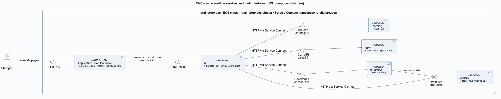
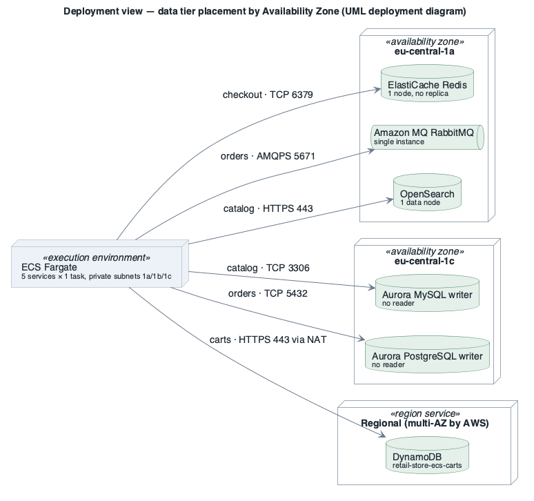

# ATAM Evaluation — retail-store-ecs (as built)

- **Date(s)**: 2026-10-09
- **Evaluation team**: ST-2 (architecture reconstruction) — evaluation leader, scribe and questioner
- **Architect(s)**: none available — the architecture is upstream (ST-6) and was deployed by the account owner (ST-1); the recovered [Views and Beyond package](../docs/README.md) stands in for the architect's presentation
- **Architecture evaluated**: as-built deployment of 2026-10-09, described in [`../docs/`](../docs/README.md) v0.1; evidence in [`../../aws/`](../../aws/README.md)
- **Mode**: Lightweight Architecture Evaluation (Steps 7–8 omitted)
- **Stakeholders**: [`../drivers/stakeholders.md`](../drivers/stakeholders.md)
- **Status**: Phase 3 complete (lightweight)

> **Limits of this evaluation.** The ATAM's cardinal rule — a willingly participating architect — and
> its Phase 2 stakeholder round could not be met. Business goals and scenario priorities are
> *derived — confirm*. Findings about **structure and configuration** are high-confidence (read from
> the deployment); findings about **importance** depend on ST-1's answer to one open question: is this
> environment demo-only or a production candidate ([BG-4](../drivers/business-goals/BG-4.md), [CON-5](../drivers/constraints/CON-5.md))?
> Re-run as a Full ATAM with ST-1, ST-3 and ST-4 before acting on the priorities.

---

## Phase 0 — Partnership and preparation

- **Scope**: all resources tagged `environment-name=retail-store-ecs` plus the untagged resources they
  use, in account 111122223333 / eu-central-1. Out of scope: co-tenant workloads (except shared account
  controls), application source code (upstream, [CON-3](../drivers/constraints/CON-3.md)).
- **Stakeholders for Phase 2**: ST-1, ST-3, ST-4, ST-5 representative — **not yet named**; Phase 2 not held.
- **Schedule**: single architect-led session, 2026-10-09.
- **Who sees the results**: the account owner (ST-1); the report contains account identifiers and should
  stay private.

## Step 1 — Present the ATAM

Method and outputs explained: architectural approaches, utility tree, scenario analyses, risks,
non-risks, sensitivity points, tradeoff points, risk themes. Lightweight mode: Steps 1–6 and 9.

## Step 2 — Present the business drivers

| ID | Business goal |
|----|---------------|
| BG-1 | Representative container reference workload on ECS — demonstrate and learn AWS container and managed-service patterns (stated upstream purpose) |
| BG-2 | End-to-end shopping journey works — every completed checkout produces a stored order |
| BG-3 | Cost proportionate to a non-production workload (derived) |
| BG-4 | Safe to expose and recoverable — protect shopper data, detect misuse, recover (scope depends on ST-1's decision) |

- **Primary functional requirements**: [UC-1](../drivers/use-cases/UC-1.md)–[UC-5](../drivers/use-cases/UC-5.md)
  (browse, search, cart, check out, place order); [UC-6](../drivers/use-cases/UC-6.md) deploy;
  [UC-7](../drivers/use-cases/UC-7.md) diagnose.
- **Constraints**: AWS eu-central-1 in a shared account (CON-1); ECS Fargate (CON-2); upstream images
  1.6.3, code not owned (CON-3); provider set fixed by the images (CON-4); upstream "not for production"
  (CON-5); Terraform (CON-6).
- **Most important quality attributes**: availability and recoverability (reliability), security
  (confidentiality, integrity, accountability), observability.

## Step 3 — Present the architecture

- **Technical constraints**: as above; additionally the account has no security baseline
  ([AC-3](../drivers/concerns/AC-3.md)).
- **External systems**: Amazon ECR Public (images), AWS regional services (CloudWatch, Secrets Manager,
  Systems Manager), future order consumers.
- **Overview**: five Fargate services behind one internet-facing Application Load Balancer, calling each
  other through ECS Service Connect; each owns its managed store; orders publishes events to RabbitMQ.
  Network spans three Availability Zones; everything else runs as one instance.

Runtime services (from the [C&C view](../docs/view-cnc-runtime.md)) — visually verified: yes

Data-tier placement (from the [deployment view](../docs/view-allocation-deployment.md)) — visually verified: yes

Key flows: [UC-1](../docs/view-cnc-runtime.md#uc-1--uc-2--browse-and-search-the-catalogue),
[UC-3](../docs/view-cnc-runtime.md#uc-3--manage-shopping-cart),
[UC-4/UC-5](../docs/view-cnc-runtime.md#uc-4--uc-5--check-out-and-place-order),
[UC-6](../docs/view-cnc-runtime.md#uc-6--deploy-a-new-service-version).

## Step 4 — Identify architectural approaches

| ID | Approach / style / tactic | Where applied | Intended quality attribute |
|----|---------------------------|---------------|----------------------------|
| AA-1 | Microservices with database per service | 5 services, 6 stores, one owner each | modifiability, fault isolation, BG-1 demonstration |
| AA-2 | Service discovery with sidecar proxy (ECS Service Connect, synchronous HTTP) | all service-to-service calls, `retailstore.local` | modifiability (location transparency), simplicity |
| AA-3 | Publish-subscribe via message broker | orders → Amazon MQ (RabbitMQ) | integrability |
| AA-4 | Managed backing services | Aurora, DynamoDB, ElastiCache, OpenSearch, Amazon MQ | operability, reliability of storage |
| AA-5 | Health monitoring + automatic replacement (ping/echo, monitor, restart) | container health checks, target-group health check, ECS scheduler | availability (detect and recover from faults) |
| AA-6 | Rolling deployment, minimum healthy 100 % / maximum 200 % | all ECS services | deployability, availability during change |
| AA-7 | Network segmentation: public/private subnets, per-store security groups | VPC, store security groups | security (limit exposure, limit access) |
| AA-8 | Externalised, scoped secrets | Secrets Manager + per-service execution roles | security (limit access) |
| AA-9 | Configuration-time binding (defer binding) | `RETAIL_*` environment variables | modifiability |
| AA-10 | Multi-AZ network and load balancer, single-instance compute and data | VPC + ALB in 3 AZ; 1 task, 1 node, 1 NAT | cost (BG-3) |
| AA-11 | Managed automated backups | Aurora 7-day point-in-time recovery | recoverability |
| AA-12 | Centralised logging + platform metrics | log group `retail-store-ecs-tasks`, Container Insights enhanced | observability |

## Step 5 — Quality attribute utility tree

Imported from the [drivers register](../drivers/quality-attributes/utility-tree.md) (architect-built,
no QAW). `(V, R)` = (business value, technical risk); `★` = (H, H). Status reflects this evaluation.

| Quality attribute | Refinement (concern) | Leaf scenario (ID — one line + measure) | Priority (V, R) | Status |
|-------------------|----------------------|----------------------------------------|:---------------:|:------:|
| Reliability | Availability / fault tolerance | AQA-2 — AZ 1a loss: browse + cart back ≤ 5 min, 0 committed orders lost | (H, H) `★` | at risk |
| Reliability | Availability | AQA-1 — single task failure: 0 failed requests, < 1 % 5xx over 5 min | (H, M) | at risk |
| Reliability | Recoverability | RQA-1 — orders RPO ≤ 5 min / RTO ≤ 4 h; carts RPO ≤ 24 h | (H, M) | at risk |
| Security | Integrity | SQA-2 — 0 paths outside the intended graph; 0 foreign secrets readable | (H, M) | at risk |
| Security | Confidentiality | SQA-1 — 100 % external TLS 1.2+; 0 plaintext hops with PII | (H, L) | at risk |
| Security | Accountability | SQA-3 — 100 % API calls recorded; alert ≤ 15 min | (H, L) | at risk |
| Observability (cross-cutting) | Monitorability | OQA-1 — notification ≤ 5 min; 100 % services alarmed | (H, L) | at risk |
| Flexibility | Scalability | SCQA-1 — 10× spike: capacity in ≤ 5 min, < 1 % 5xx | (M, H) | at risk |
| Flexibility | Installability (deployability) | DQA-1 — bad version: 0 shopper errors, rollback ≤ 10 min | (M, L) | at risk |
| Performance efficiency | Time behaviour | PQA-1 — catalogue p95 ≤ 1 s at 50 shoppers | (M, M) | open |
| Performance efficiency | Resource utilisation | PQA-2 — average CPU ≥ 40 % or justified | (M, L) | open |
| Maintainability | Modifiability | MQA-1 — swap provider: 0 code lines, ≤ 1 revision, ≤ 1 day | (M, L) | addressed |
| Integrability (cross-cutting) | Integrability | INQA-1 — new order consumer: 0 changes to orders, ≤ 2 days | (M, L) | addressed |

_Reading the tree_: Step 6 analyses the `★` and (H, M) leaves (AQA-2, AQA-1, RQA-1, SQA-2), then —
because they are cheap to settle and high in value — the (H, L) leaves SQA-1, SQA-3, OQA-1, and briefly
the (M, H) SCQA-1 and the non-risk candidates DQA-1, MQA-1, INQA-1. PQA-1 and PQA-2 were not analysed:
no load or utilisation data exists to analyse them against (recommendation: measure first).

## Step 6 — Analyse architectural approaches (Phase 1 scenarios)

### AQA-2 — Loss of Availability Zone eu-central-1a (H, H) ★
- **Attribute / refinement**: Reliability / availability, fault tolerance
- **Approaches invoked**: AA-10, AA-4, AA-5, AA-2
- **Analysis questions & answers** (availability tactics questionnaire):
  - Q: Is there redundancy for every element on the shopper's path? A: Only the load balancer and the
    network. Services: 1 task each; Redis, MQ, OpenSearch: 1 node in 1a; Aurora: 1 writer each in 1c.
  - Q: Does egress survive an AZ loss? A: No. One NAT Gateway in 1a; the private route table sends all
    three AZs through it; no VPC endpoints. Without 1a, tasks elsewhere cannot reach DynamoDB, ECR
    Public, CloudWatch Logs or Secrets Manager — **replacement tasks cannot even start** (image pull and
    secret injection fail).
  - Q: Is there failover for state? A: Aurora has no reader to promote; Redis `AutomaticFailover:
    disabled`; MQ `SINGLE_INSTANCE`; OpenSearch `ZoneAwareness: false`.
  - Q: Would anyone notice? A: No alarms (see OQA-1).

| Finding | Type | Element / decision | Affected attribute(s) | Note |
|---------|------|--------------------|-----------------------|------|
| R-2 | Risk | Single-AZ data tier without failover | Reliability / availability | 1a loss stops checkout, order events, search; 1c loss stops catalogue and orders |
| R-3 | Risk | One NAT Gateway for all AZs, no VPC endpoints | Reliability / availability | 1a loss removes all egress; tasks cannot be replaced anywhere |
| N-6 | Non-risk | Load balancer and subnets in 3 AZs | Reliability / availability | assumption: tasks and data are made redundant — then the network needs no change |
| SP-2 | Sensitivity | Number and placement of NAT Gateways / endpoints | Availability | per-AZ NAT or gateway endpoints remove the single egress point |
| SP-3 | Sensitivity | Aurora instance count and AZ | Availability, RTO | a reader in another AZ turns hours into < 1 min failover |
| TP-1 | Tradeoff | Single-instance everything (AA-10) | Cost / resource utilisation ↑ vs availability ↓ | BG-3 vs BG-2/BG-4 |
| TP-2 | Tradeoff | NAT Gateway count | Availability ↑ vs cost ↑ (fixed hourly charge per gateway) | partially offset by gateway endpoints, which cut NAT data charges |

### AQA-1 — Single task failure of the storefront (H, M)
- **Attribute / refinement**: Reliability / availability
- **Approaches invoked**: AA-5, AA-1, AA-2
- **Analysis questions & answers**:
  - Q: How is a failed task detected? A: Container health check (`curl /actuator/health` or `/health`) and,
    for `ui`, the target-group health check. Detection works.
  - Q: Is there a spare to take the load meanwhile? A: No — `desiredCount 1` on every service, so the
    journey is down until the replacement starts, pulls its image and passes health checks.
  - Q: Do calls between services degrade gracefully? A: Not visible at the infrastructure level; every call
    is synchronous (AA-2), so `ui` depends on four services being up at the same time.

| Finding | Type | Element / decision | Affected attribute(s) | Note |
|---------|------|--------------------|-----------------------|------|
| R-1 | Risk | `desiredCount 1` on all five services | Reliability / availability | any task failure, deployment hiccup or Fargate retirement is a visible outage |
| N-9 | Non-risk | Health checks + automatic replacement (AA-5) | Reliability / availability | assumption: health endpoints reflect real readiness |
| SP-1 | Sensitivity | `desiredCount` per service | Availability, cost | 1 → 2 across AZs removes the single point of failure |
| SP-4 | Sensitivity | Health-check interval / thresholds | Availability (detection time) | shorter = faster replacement, more false positives |
| TP-5 | Tradeoff | Synchronous call chain via Service Connect (AA-2) | Modifiability / simplicity ↑ vs availability ↓ | journey availability is the product of every service's availability |

### RQA-1 — Restore after data corruption or deletion (H, M)
- **Attribute / refinement**: Reliability / recoverability
- **Approaches invoked**: AA-11, AA-4
- **Analysis questions & answers**:
  - Q: Can each store be restored to a point in time? A: Aurora yes (7 days). DynamoDB no (point-in-time
    recovery disabled). Redis no (0 snapshots — acceptable only if checkout sessions are disposable).
  - Q: Is accidental deletion prevented? A: No — deletion protection is off on both Aurora clusters and the
    DynamoDB table; Terraform `destroy` would remove them.
  - Q: Are backups copied out of the account/region? A: No AWS Backup plan, no cross-region copy.
  - Q: Has a restore been tested? A: No evidence; RTO unknown.

| Finding | Type | Element / decision | Affected attribute(s) | Note |
|---------|------|--------------------|-----------------------|------|
| R-4 | Risk | DynamoDB point-in-time recovery off; deletion protection off everywhere; no AWS Backup; no restore test | Reliability / recoverability | carts unrecoverable; one command deletes all data |
| N-7 | Non-risk | Aurora automated backups, 7-day point-in-time recovery, encrypted | Reliability / recoverability | assumption: a restore within 7 days meets RPO/RTO once tested |

### SQA-2 — Containment of a compromised service (H, M)
- **Attribute / refinement**: Security / integrity
- **Approaches invoked**: AA-7, AA-8, AA-1
- **Analysis questions & answers** (security tactics: limit access, limit exposure, separate entities):
  - Q: Can a compromised task reach another service's store? A: No — each store's security group admits
    only its owner's task security group. Good.
  - Q: Can it read another service's secrets? A: No — execution roles are scoped to their own secrets.
  - Q: Can anything in the VPC reach every service? A: Yes — all task security groups allow 8080 from
    `0.0.0.0/0`. Today only these tasks live in the VPC, so the exposure is latent.
  - Q: Are task roles least-privilege? A: Mostly; `checkout-task` holds `dynamodb:*` on the carts table it
    never uses, and `carts-task` holds `dynamodb:*` rather than item-level actions.
  - Q: Can an operator or attacker with IAM access open a shell in any container? A: Yes — ECS Exec on all
    five services, and no CloudTrail to record it.

| Finding | Type | Element / decision | Affected attribute(s) | Note |
|---------|------|--------------------|-----------------------|------|
| R-7 | Risk | Task security groups: TCP 8080 from 0.0.0.0/0 | Security / integrity | should be caller-scoped (ALB → ui; ui → others; checkout → orders) |
| R-8 | Risk | `checkout-task` has `dynamodb:*` on the carts table; `carts-task` has `dynamodb:*` | Security / integrity | excess privilege → cart tampering from checkout |
| R-9 | Risk | ECS Exec enabled on all services, unaudited | Security / integrity, accountability | interactive access to PII-bearing containers |
| N-1 | Non-risk | Per-store security groups, one owner per store (AA-1, AA-7) | Security / integrity | assumption: no shared database or broad security-group rule is added later |
| N-2 | Non-risk | Secrets in Secrets Manager, scoped per execution role (AA-8) | Security / confidentiality | assumption: values injected as environment variables are acceptable and ECS Exec is restricted |
| SP-7 | Sensitivity | Source of task security-group ingress | Integrity | 0.0.0.0/0 → caller security group shrinks the reachable set to the call graph |
| TP-4 | Tradeoff | ECS Exec on all services | Operability / diagnosability ↑ (UC-7) vs security ↓ (SQA-2, SQA-3) | enable per incident instead |

### SQA-1 — Shopper traffic confidentiality in transit (H, L)
- **Attribute / refinement**: Security / confidentiality
- **Approaches invoked**: AA-2, AA-4, AA-7
- **Analysis questions & answers**:
  - Q: Is the public edge encrypted? A: No — the only listener is HTTP:80; no certificate, no redirect, no WAF.
  - Q: Internal hops? A: Service Connect without TLS; Redis without TLS/AUTH and **unencrypted at rest**;
    Aurora does not require TLS. AMQPS and OpenSearch HTTPS are correct.

| Finding | Type | Element / decision | Affected attribute(s) | Note |
|---------|------|--------------------|-----------------------|------|
| R-5 | Risk | Public listener HTTP:80 only | Security / confidentiality | PII (address, e-mail) crosses the internet in clear |
| R-6 | Risk | Plaintext internal hops: Service Connect, Redis (also unencrypted at rest, no AUTH), Aurora TLS not enforced | Security / confidentiality | whether the upstream images can use TLS to Redis/Aurora must be checked (CON-3) |
| N-8 | Non-risk | AMQPS to Amazon MQ; OpenSearch HTTPS, node-to-node encryption, fine-grained access control | Security / confidentiality | assumption: TLS 1.2 policies stay current |
| TP-3 | Tradeoff | TLS on every hop | Confidentiality ↑ vs time behaviour (handshake latency) and operability ↓ (private CA, certificate rotation) | small latency cost; real cost is the Private CA |

### SQA-3 — Detection of suspicious control-plane activity (H, L)
- **Attribute / refinement**: Security / accountability
- **Approaches invoked**: none present (account baseline missing)
- **Analysis questions & answers**: Q: Is there an audit trail? A: No CloudTrail trail. Q: Threat detection?
  A: GuardDuty, Security Hub, Config all off; no VPC Flow Logs; no load-balancer access logs.

| Finding | Type | Element / decision | Affected attribute(s) | Note |
|---------|------|--------------------|-----------------------|------|
| R-10 | Risk | No CloudTrail, GuardDuty, Config, Security Hub, Flow Logs or access logs | Security / accountability | shared account: an incident in any co-tenant is equally invisible (AC-1, AC-3) |

### OQA-1 — Operators learn of failures before shoppers (H, L)
- **Attribute / refinement**: Observability / monitorability
- **Approaches invoked**: AA-12, AA-5
- **Analysis questions & answers**: Q: What raises an alert? A: Nothing — 0 alarms, no SNS topic.
  Q: How long is evidence kept? A: Task logs forever (cost grows unbounded); Container Insights 1 day;
  MQ logs off; Aurora log exports off.

| Finding | Type | Element / decision | Affected attribute(s) | Note |
|---------|------|--------------------|-----------------------|------|
| R-11 | Risk | No alarms or notifications; inconsistent log retention | Observability / monitorability | shoppers are the monitoring system |
| SP-6 | Sensitivity | Log retention | Diagnosability vs cost | 1 day too short, "never" too long |

### SCQA-1 — Demand spike (M, H)
- **Approaches invoked**: AA-10, AA-4
- **Answer**: no ECS auto scaling; Aurora, Redis, MQ and OpenSearch are fixed single nodes; DynamoDB on-demand scales.

| Finding | Type | Element / decision | Affected attribute(s) | Note |
|---------|------|--------------------|-----------------------|------|
| R-12 | Risk | No Application Auto Scaling; fixed data-tier sizes, burstable Aurora `db.t3.medium` | Flexibility / scalability | spikes exhaust CPU credits and the single task |

### DQA-1, MQA-1, INQA-1 — non-risk candidates
- **DQA-1** (AA-6): a good release causes no downtime (old task kept until the new one is healthy) →
  **N-5** (assumption: health endpoints reflect readiness). But a bad release is never rolled back and
  images come straight from a public registry → **R-13**.
- **MQA-1** (AA-9): providers and endpoints bound by environment variables → **N-3** (assumption: the
  target provider is supported by the image, CON-4).
- **INQA-1** (AA-3): orders publishes to a broker; consumers attach without changing orders → **N-4**
  (assumption: a new consumer is granted a security-group rule and credentials; upstream event schema stays stable).
- Version currency (AC-4): Redis **4.0.10** is several majors old → **R-14** (maintainability / security).

| Finding | Type | Element / decision | Affected attribute(s) | Note |
|---------|------|--------------------|-----------------------|------|
| R-13 | Risk | Circuit breaker off; images pulled unmirrored from ECR Public | Flexibility / installability | failed release loops; registry outage or rate-limit blocks scaling and recovery |
| R-14 | Risk | ElastiCache Redis 4.0.10 | Maintainability; security | upgrading to 7.x needs a new cluster (also the moment to enable encryption) |
| N-3 | Non-risk | Configuration-time binding (AA-9) | Maintainability / modifiability | assumption: provider supported by the image |
| N-4 | Non-risk | Broker intermediary (AA-3) | Integrability | assumption: consumers get network access and credentials |
| N-5 | Non-risk | Rolling 100/200 (AA-6) | Flexibility / installability | assumption: health endpoints reflect readiness |
| SP-5 | Sensitivity | Redis node count / failover | Availability of checkout | replica + automatic failover keeps sessions |

## Step 7 — Brainstorm and prioritise scenarios (Phase 2)

Omitted — Lightweight mode; no stakeholder group available. Recommended for the Full ATAM re-run.

## Step 8 — Analyse architectural approaches (Phase 2 scenarios)

Omitted — Lightweight mode.

## Step 9 — Results

### Architectural approaches
AA-1 microservices with database per service · AA-2 Service Connect discovery (synchronous HTTP) ·
AA-3 publish-subscribe (Amazon MQ) · AA-4 managed backing services · AA-5 health monitoring and
replacement · AA-6 rolling deployment · AA-7 network segmentation · AA-8 scoped secrets · AA-9
configuration-time binding · AA-10 multi-AZ network with single-instance compute/data · AA-11 managed
backups · AA-12 centralised logging and metrics.

### Risks
| ID | Risk | Affected attribute | Related driver |
|----|------|--------------------|----------------|
| R-1 | One task per service — any task failure is an outage of that function (ui = whole store) | Reliability / availability | AQA-1, BG-2 |
| R-2 | Single-AZ data tier with no failover (Aurora ×2 in 1c; Redis, MQ, OpenSearch in 1a) | Reliability / availability | AQA-2, BG-2, BG-4 |
| R-3 | Single NAT Gateway in 1a for all AZs, no VPC endpoints — 1a loss blocks all egress and task replacement | Reliability / availability | AQA-2, UC-3, UC-6 |
| R-4 | DynamoDB point-in-time recovery off, deletion protection off, no AWS Backup, no restore test | Reliability / recoverability | RQA-1, BG-4 |
| R-5 | Public listener HTTP only | Security / confidentiality | SQA-1, BG-4 |
| R-6 | Plaintext internal hops; Redis unencrypted at rest, no AUTH | Security / confidentiality | SQA-1, SQA-2 |
| R-7 | Task security groups open TCP 8080 to 0.0.0.0/0 | Security / integrity | SQA-2 |
| R-8 | Excess IAM: checkout `dynamodb:*` on carts; carts `dynamodb:*` | Security / integrity | SQA-2 |
| R-9 | ECS Exec on all services, unaudited | Security / integrity, accountability | SQA-2, SQA-3 |
| R-10 | No CloudTrail, GuardDuty, Config, Security Hub, Flow Logs, access logs | Security / accountability | SQA-3, AC-3 |
| R-11 | No alarms or notifications; log retention never / 1 day | Observability | OQA-1, UC-7 |
| R-12 | No auto scaling; fixed single-node data tier on burstable classes | Flexibility / scalability | SCQA-1 |
| R-13 | Circuit breaker off; unmirrored public images | Flexibility / installability | DQA-1, UC-6 |
| R-14 | Redis 4.0.10 (old major) | Maintainability, security | AC-4 |

### Non-risks
| ID | Non-risk | Assumption under which it holds |
|----|----------|--------------------------------|
| N-1 | Per-store security groups — each store reachable only from its owning service | no shared database or broad rule is added |
| N-2 | Secrets scoped per execution role in Secrets Manager | env-var injection acceptable; ECS Exec restricted |
| N-3 | Providers bound by configuration (MQA-1) | target provider supported by the image |
| N-4 | Order events via broker (INQA-1) | consumers granted network access and credentials; schema stable |
| N-5 | Rolling 100/200 keeps the old task until the new one is healthy | health endpoints reflect readiness |
| N-6 | Network and load balancer already span 3 AZs | tasks and data stores are made redundant |
| N-7 | Aurora encrypted with 7-day point-in-time recovery | a tested restore meets the agreed RPO/RTO |
| N-8 | AMQPS to the broker; OpenSearch HTTPS + node-to-node + fine-grained access control | TLS policies kept current |
| N-9 | Health checks with automatic task replacement | health endpoints reflect real readiness |

### Sensitivity points
| ID | Element property | Attribute affected | Direction |
|----|------------------|--------------------|-----------|
| SP-1 | `desiredCount` per service | Availability; cost | 1 → ≥ 2 across AZs: availability ↑, cost ↑ |
| SP-2 | NAT Gateway count / VPC endpoints | Availability of all egress | per-AZ NAT or endpoints: single point removed |
| SP-3 | Aurora instance count and AZ | Availability, RTO | reader in another AZ: failover < 1 min |
| SP-4 | Health-check interval / thresholds | Detection time | shorter: faster recovery, more false positives |
| SP-5 | Redis replica / automatic failover | Checkout availability | replica: sessions survive node loss |
| SP-6 | Log retention | Diagnosability; cost | longer: more evidence, more cost |
| SP-7 | Task security-group ingress source | Integrity | caller-scoped: reachable set = call graph |

### Tradeoff points
| ID | Element property | Attribute A ↑ | Attribute B ↓ |
|----|------------------|---------------|---------------|
| TP-1 | Single instance of everything (AA-10) | Cost / resource utilisation (BG-3, PQA-2) | Availability (AQA-1, AQA-2) |
| TP-2 | Number of NAT Gateways | Availability (AQA-2) | Cost (BG-3) |
| TP-3 | TLS on every internal hop | Confidentiality (SQA-1) | Time behaviour and operability (PQA-1) |
| TP-4 | ECS Exec enabled | Diagnosability (UC-7) | Security (SQA-2, SQA-3) |
| TP-5 | Synchronous call chain via Service Connect | Modifiability / simplicity (MQA-1) | Availability (AQA-1) |

### Risk themes
| Theme | Risks | Business driver(s) endangered | Recommendation |
|-------|-------|------------------------------|----------------|
| RT-1 Single instance by default | R-1, R-2, R-3, R-12 | BG-2, BG-4 (in tension with BG-3) | `/add` iteration on availability: ≥ 2 tasks per service across AZs, NAT per AZ + DynamoDB/S3 gateway endpoints, Aurora reader in a second AZ, Redis replica with failover, MQ cluster, OpenSearch zone awareness; ECS target-tracking auto scaling. Price it with CBAM against BG-3 |
| RT-2 Open edge and plaintext interior | R-5, R-6, R-7, R-8, R-9, R-14 | BG-4 | HTTPS listener (ACM) + redirect + AWS WAF; caller-scoped task security groups; remove checkout's DynamoDB access; ECS Exec off by default; TLS for Aurora (`rds.force_ssl=1` / `require_secure_transport=ON`) and Redis (new 7.x cluster with in-transit + at-rest encryption and AUTH) — after confirming the images support it (CON-3) |
| RT-3 Operating blind | R-10, R-11, R-13 | BG-4, BG-1 | Account baseline: multi-region CloudTrail, GuardDuty (with ECS runtime monitoring), Config, Security Hub; CloudWatch alarms → SNS for ALB 5xx / unhealthy hosts / running-task count / data-store health; log retention 30–90 days; deployment circuit breaker with rollback; mirror images to private ECR with scanning |
| RT-4 Unrecoverable data | R-4 | BG-4, BG-2 | Agree RPO/RTO with ST-1; DynamoDB point-in-time recovery; deletion protection; AWS Backup plan with cross-region copy; quarterly restore test |

### Recommendations / next steps
1. **Decide the environment's purpose (ST-1).** Demo-only → do the account-wide and cheap items now
   (RT-3 account baseline, R-7, R-8, R-9, R-4 deletion protection + PITR, log retention) and accept
   RT-1 explicitly. Production candidate → all four themes, starting with RT-2 and RT-3, then RT-1.
2. **Account baseline first** (R-10): it protects every co-tenant too ([AC-1](../drivers/concerns/AC-1.md),
   [AC-3](../drivers/concerns/AC-3.md)) and costs little.
3. **Targeted `/add` iterations**, one per theme, recording ADRs: iteration 1 RT-1 (drivers AQA-2, AQA-1,
   SCQA-1), iteration 2 RT-2 (SQA-1, SQA-2), iteration 3 RT-3/RT-4 (SQA-3, OQA-1, RQA-1, DQA-1).
4. **CBAM** to rank RT-1 measures by availability gained per cost (TP-1, TP-2) — cost figures need
   Cost Explorer data, which is unavailable until the `environment-name` tag is activated for cost
   allocation (G-12 in the [intake](../brownfield-intake.md)).
5. **Measure before tuning performance**: load-test UC-1 and record a baseline for PQA-1/PQA-2.
6. **Locate the Terraform source and state** ([AC-2](../drivers/concerns/AC-2.md)); land every change there ([CON-6](../drivers/constraints/CON-6.md)).
7. **Re-run as a Full ATAM** with named stakeholders to confirm the drivers and priorities.

### Drivers register write-back
- Scenarios with ≥ 1 Risk set to `at risk` in [`../drivers/README.md`](../drivers/README.md):
  AQA-1 (R-1), AQA-2 (R-2, R-3), RQA-1 (R-4), SQA-1 (R-5, R-6), SQA-2 (R-6, R-7, R-8, R-9), SQA-3 (R-9, R-10),
  OQA-1 (R-11), SCQA-1 (R-12), DQA-1 (R-13).
- Scenarios found supported by the as-built architecture set to `addressed`: MQA-1 (N-3), INQA-1 (N-4).
- Business goals threatened by risk themes set to `at risk`: BG-2 (RT-1, RT-4), BG-4 (RT-1–RT-4).
- Change-log line appended to the drivers README and to the package index `../README.md`.

---

**Navigation**: [architecture package](../README.md) · [drivers](../drivers/README.md) · [docs](../docs/README.md) · [brownfield intake](../brownfield-intake.md)
