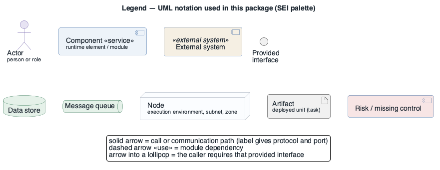

# Architecture description — retail-store-ecs (as built)

- **Date**: 2026-10-09
- **Status**: draft 0.2 — reconstructed from the running deployment; awaiting review by ST-1, ST-3, ST-4
- **Approach**: SEI Views and Beyond (Clements et al., *Documenting Software Architectures*, 2nd ed.)
- **Evidence**: read-only AWS evidence in [`../../aws/`](../../aws/README.md); drivers in [`../drivers/`](../drivers/README.md)

## 1. Documentation roadmap

This package describes the architecture of `retail-store-ecs` **as it is deployed** on 2026-10-09
in AWS account 111122223333 (eu-central-1). It is descriptive: it records what exists and why it most
likely exists. The evaluation of that architecture against its drivers is in the
[ATAM report](../atam/atam-report.md).

| Part | File |
|------|------|
| System overview (purpose, context, use cases, driving scenarios) | [system-overview.md](system-overview.md) |
| **Module** viewtype — decomposition + uses | [view-module-decomposition.md](view-module-decomposition.md) |
| **Component-and-Connector** viewtype — runtime services (primary C&C view, with behaviour per use case) | [view-cnc-runtime.md](view-cnc-runtime.md) |
| **Allocation** viewtype — deployment | [view-allocation-deployment.md](view-allocation-deployment.md) |
| Quality view — security | [view-security.md](view-security.md) |
| Quality view — observability | [view-observability.md](view-observability.md) |
| Mapping between views | [mapping-between-views.md](mapping-between-views.md) |
| Rationale (recovered decisions) | [rationale.md](rationale.md) |
| Directory (index, glossary, acronyms) | [directory.md](directory.md) |
| Change log | [change-log.md](change-log.md) |

Legend for every diagram (UML symbols used and the meaning of colour, SEI palette):

Source: [`diagrams/legend.puml`](diagrams/legend.puml)

## 2. How the documentation is organised

Each view file is a **view packet** with five sections: 1 primary presentation, 2 element catalog
(elements, relations, interfaces, behaviour), 3 context diagram, 4 variability guide, 5 rationale.
All diagrams are **UML**, drawn in PlantUML: component diagrams (context, module and C&C views),
deployment diagrams (allocation view, security trust zones), sequence diagrams (behaviour, one per
architecturally significant use case) and use case diagrams (drivers register). Every `.puml` source
sits next to its rendered PNG in `diagrams/`.

### View selection

| Stakeholder ([register](../drivers/stakeholders.md)) | Concerns | Views |
|------------------------------------------------------|----------|-------|
| ST-1 account owner | what it is, what it costs, what the risks are | system overview, deployment, security, ATAM |
| ST-2 architect / future architect | structure, decisions, consistency | all views, mapping, rationale |
| ST-3 operator / SRE | where it runs, how it fails, how to deploy and diagnose | deployment, C&C (UC-6 sequence), observability |
| ST-4 security | exposure, data in transit/at rest, identities, detection | security, C&C relations table |
| ST-5 shopper (represented) | journeys work | C&C behaviour (UC-1–UC-5) |
| ST-6 upstream maintainers | how their images are configured | module view (variability guide) |
| ST-7 co-tenants | shared account effects | deployment §3, security §3 |

### Where do I look to answer…

| Question | Look in |
|----------|---------|
| What happens if eu-central-1a goes down? | [deployment view §2.4](view-allocation-deployment.md#24-element-behavior), [AQA-2](../drivers/quality-attributes/AQA-2.md) |
| Which service talks to which database, on which port? | [C&C view §2.2](view-cnc-runtime.md#22-relations-and-their-properties), [mapping](mapping-between-views.md) |
| Is shopper data encrypted in transit? | [security view §2.1](view-security.md#21-elements-and-their-properties) |
| How do I roll out a new image version and what if it fails? | [C&C view UC-6](view-cnc-runtime.md#uc-6--deploy-a-new-service-version) |
| How would I know a service is down? | [observability view](view-observability.md) |
| Can I switch a service to another store? | [module view §4](view-module-decomposition.md#4-variability-guide) |
| Why is it built this way? | [rationale](rationale.md) |

---

**Navigation**: [system overview](system-overview.md) · [module view](view-module-decomposition.md) · [C&C view](view-cnc-runtime.md) · [deployment view](view-allocation-deployment.md) · [security view](view-security.md) · [observability view](view-observability.md) · [mapping](mapping-between-views.md) · [rationale](rationale.md) · [directory](directory.md) · [change log](change-log.md) · [architecture package](../README.md) · [drivers](../drivers/README.md)
