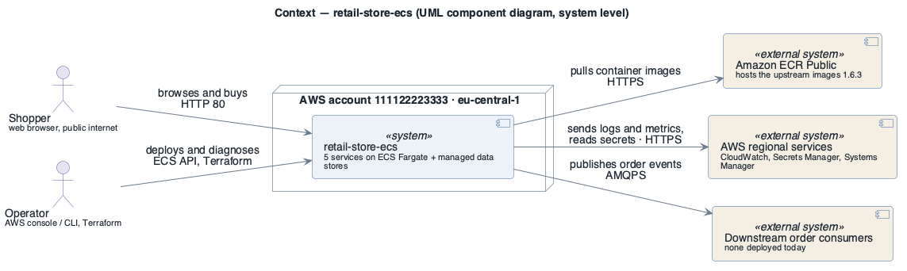

# System overview — retail-store-ecs

- **Date**: 2026-10-09
- **Status**: as-built description (reconstructed from the running deployment — see [brownfield intake](../brownfield-intake.md))

## What the system does

`retail-store-ecs` is a deployment of the open-source **AWS Containers Retail Sample App**
(release 1.6.3) on **Amazon ECS with AWS Fargate** in AWS region eu-central-1. It is a web storefront
in which a shopper browses and searches a product catalogue, keeps a shopping cart, checks out and
places an order. The upstream project exists to demonstrate container patterns on AWS and states it is
for educational use, not production ([CON-5](../drivers/constraints/CON-5.md)).

It is built as five independently deployed microservices, each with its own backing store chosen to
exercise a different AWS managed service:

| Service | Language (upstream) | Backing services (as deployed) |
|---------|---------------------|--------------------------------|
| ui | Java (Spring Boot) | — (calls the other four) |
| catalog | Go | Aurora MySQL 8.0; OpenSearch 3.3 for search |
| carts | Java (Spring Boot) | DynamoDB (on-demand) |
| checkout | Node.js | ElastiCache Redis 4.0.10; calls orders |
| orders | Java (Spring Boot) | Aurora PostgreSQL 15.10; RabbitMQ 3.13 on Amazon MQ |

## Context

Source: [`diagrams/system-context.puml`](diagrams/system-context.puml) · UML, rendered with PlantUML · visually verified

_visually verified: yes_ · Legend: [diagrams/legend.png](diagrams/legend.png)

The account boundary matters: the account is **shared** with unrelated workloads
([AC-1](../drivers/concerns/AC-1.md), [CON-1](../drivers/constraints/CON-1.md)), so account-level
controls — or their absence — apply to this system too.

## Major functional requirements

The architecturally significant use cases (full detail in the [drivers register](../drivers/use-cases/README.md)):
[UC-1](../drivers/use-cases/UC-1.md) Browse product catalogue ·
[UC-2](../drivers/use-cases/UC-2.md) Search products ·
[UC-3](../drivers/use-cases/UC-3.md) Manage shopping cart ·
[UC-4](../drivers/use-cases/UC-4.md) Check out ·
[UC-5](../drivers/use-cases/UC-5.md) Place order ·
[UC-6](../drivers/use-cases/UC-6.md) Deploy a new service version ·
[UC-7](../drivers/use-cases/UC-7.md) Diagnose a running service.

## Driving quality attribute scenarios

The reconstructed priorities are in the [utility tree](../drivers/quality-attributes/utility-tree.md).
Most significant: [AQA-2](../drivers/quality-attributes/AQA-2.md) (H,H) loss of an Availability Zone,
[AQA-1](../drivers/quality-attributes/AQA-1.md) single-task failure, [RQA-1](../drivers/quality-attributes/RQA-1.md)
restore after data loss, [SQA-2](../drivers/quality-attributes/SQA-2.md) containment, and the
high-value / low-difficulty [SQA-1](../drivers/quality-attributes/SQA-1.md), [SQA-3](../drivers/quality-attributes/SQA-3.md),
[OQA-1](../drivers/quality-attributes/OQA-1.md). How well the as-built architecture meets them is
evaluated in the [ATAM report](../atam/atam-report.md).

---

**Navigation**: [docs roadmap](README.md) · [architecture package](../README.md)
