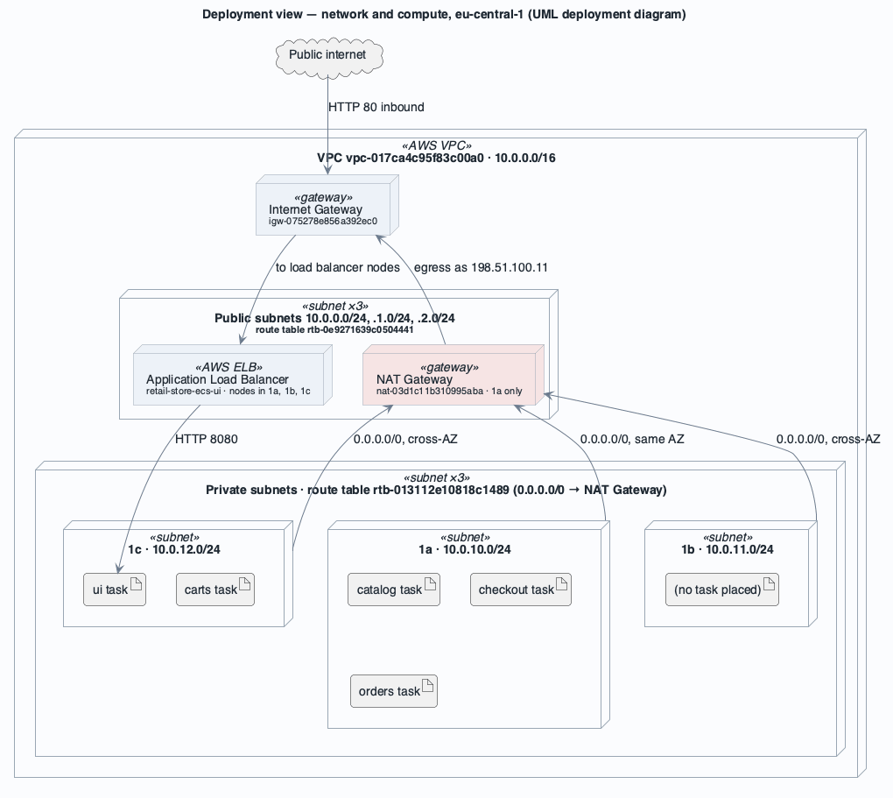
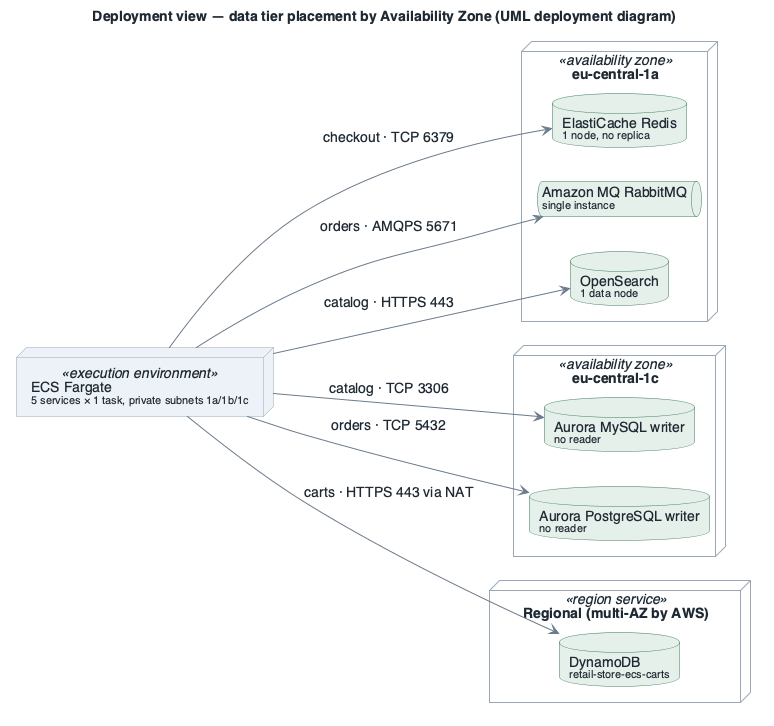

# View: Deployment  (Allocation / deployment)

- **Viewtype**: Allocation
- **Style**: deployment (software elements → AWS network and Availability Zones)
- **Stakeholders / concerns addressed**: ST-3 operator (where things run, failure domains), ST-1 owner (cost of redundancy), ST-4 security (network zones), reliability analysis of [AQA-1](../drivers/quality-attributes/AQA-1.md) and [AQA-2](../drivers/quality-attributes/AQA-2.md)
- **Date**: 2026-10-09

Two presentations: the network and compute allocation, then the data-tier placement by Availability Zone.
Task placement is a snapshot from 2026-10-09 (Fargate may place a replacement task in any of the three private subnets).

## 1. Primary presentation

### 1a. Network and compute allocation

Source: [`diagrams/view-deploy-network.puml`](diagrams/view-deploy-network.puml) · UML, rendered with PlantUML · visually verified

### 1b. Data-tier placement by Availability Zone

Source: [`diagrams/view-deploy-data.puml`](diagrams/view-deploy-data.puml) · UML, rendered with PlantUML · visually verified

_visually verified: yes · relative path renders on GitHub / GitLab_

Legend: [diagrams/legend.png](diagrams/legend.png) — the red element marks a single point of failure.

## 2. Element catalog

### 2.1 Elements and their properties

| Element (environment) | Role | Key properties |
|-----------------------|------|----------------|
| VPC `vpc-017ca4c95f83c00a0` | Network boundary | 10.0.0.0/16; default NACL (allow all); **no flow logs** |
| Public subnets ×3 | Load balancer nodes, NAT Gateway | 10.0.0.0/24 (1a), 10.0.1.0/24 (1b), 10.0.2.0/24 (1c); route `0.0.0.0/0 → igw` (`rtb-0e9271639c0504441`); no auto-assign public IP |
| Private subnets ×3 | Fargate tasks and data stores | 10.0.10.0/24 (1a), 10.0.11.0/24 (1b), 10.0.12.0/24 (1c); route `0.0.0.0/0 → nat-03d1c11b310995aba` (`rtb-013112e10818c1489`) |
| NAT Gateway | Egress for all private subnets | **one**, in 1a — single point of failure and cross-AZ data charges for 1b/1c |
| Interface VPC endpoint | Amazon MQ broker endpoint into the VPC | service `vpce-svc-014cd657e5fdb8b2f` (broker ENI for RabbitMQ) |
| Fargate tasks | Compute | platform 1.4.0, x86_64, `assignPublicIp DISABLED`, spread over the 3 private subnets |
| Data stores | Persistence | placement in 1b: none; Aurora writers in 1c; Redis, MQ, OpenSearch in 1a |

### 2.2 Relations and their properties

| Software element | Allocated to | Properties |
|------------------|--------------|-----------|
| ui, catalog, carts, checkout, orders | private subnets 1a/1b/1c (Fargate) | 1 task each; Availability-Zone rebalancing disabled |
| Load balancer | public subnets 1a/1b/1c | the only element with redundant placement |
| Redis, Amazon MQ, OpenSearch | private subnet 1a | single-AZ |
| Aurora MySQL, Aurora PostgreSQL | private subnets (subnet groups) — writer in 1c | `MultiAZ: false` |
| DynamoDB | regional AWS service | reached through the NAT Gateway |

### 2.3 Element interfaces

Network interfaces per element are described in the [security view](view-security.md) (security groups
and ports).

### 2.4 Element behavior

**Failure of eu-central-1a** (the [AQA-2](../drivers/quality-attributes/AQA-2.md) stimulus): the NAT
Gateway, Redis, MQ and OpenSearch go down. Tasks in 1b/1c lose all egress (DynamoDB, ECR Public, CloudWatch
Logs, Secrets Manager — so even replacement tasks cannot start), checkout and order events stop, search
stops. Only browsing from Aurora MySQL in 1c keeps working, if the `ui` and `catalog` tasks are not in 1a.

**Failure of eu-central-1c**: both Aurora writers go down; catalogue, orders and the `ui`/`carts` tasks
placed there fail until Aurora recovers the instance (single instance, no reader to fail over to).

## 3. Context diagram

The deployment sits in the shared account 111122223333 next to three other VPCs of unrelated
workloads; there is no peering or Transit Gateway between them ([CON-1](../drivers/constraints/CON-1.md),
[AC-1](../drivers/concerns/AC-1.md)). See the account-wide inventory in
[`aws/discovery/architecture-discovery.md`](../../aws/discovery/architecture-discovery.md).

## 4. Variability guide

| Variation point | How to exercise it |
|-----------------|--------------------|
| Number of NAT Gateways | one per Availability Zone with per-AZ private route tables |
| Data-store redundancy | Aurora reader in another AZ; Redis replica + automatic failover; MQ `CLUSTER_MULTI_AZ`; OpenSearch zone awareness |
| Task spread | `desiredCount ≥ 3` with Availability-Zone rebalancing enabled |
| Private AWS access | gateway endpoints for DynamoDB and S3; interface endpoints for ECR, CloudWatch Logs, Secrets Manager |

## 5. Rationale

The layout — three Availability Zones in the network but one instance of everything else — is the
cheapest one that still shows the full topology ([BG-3](../drivers/business-goals/BG-3.md),
[BG-1](../drivers/business-goals/BG-1.md)). It satisfies [CON-2](../drivers/constraints/CON-2.md) but
fails [AQA-1](../drivers/quality-attributes/AQA-1.md) and [AQA-2](../drivers/quality-attributes/AQA-2.md):
the network is ready for multi-AZ, the workload is not. Raising redundancy is mostly configuration, which
is why the ATAM rates it a risk rather than a structural flaw.

---

**Navigation**: [docs roadmap](README.md) · [architecture package](../README.md)
