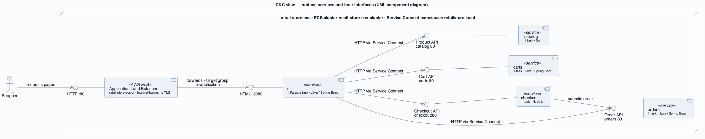
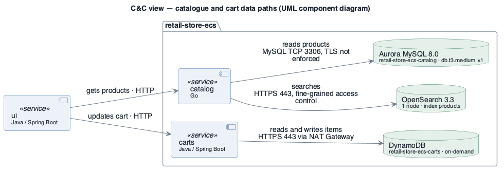
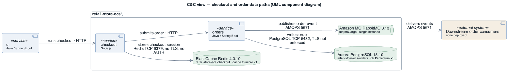
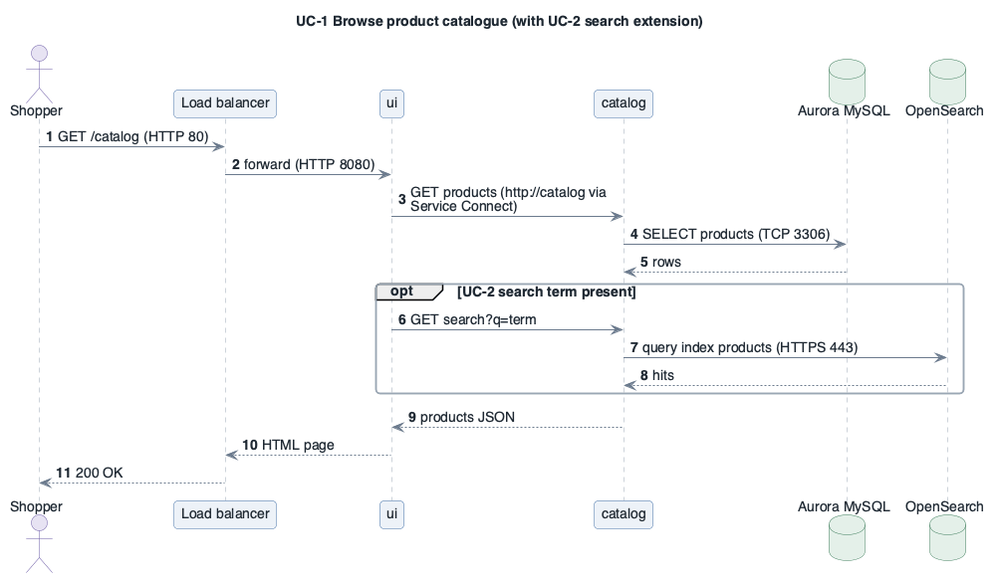
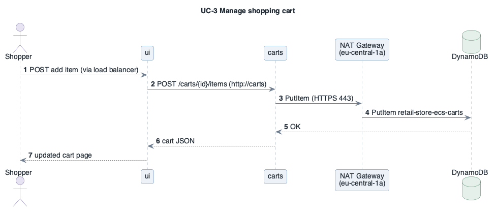
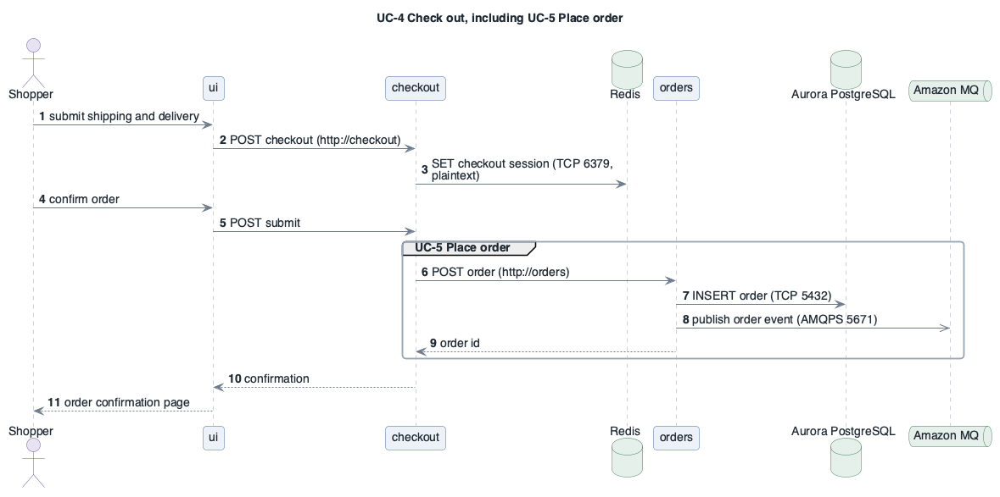
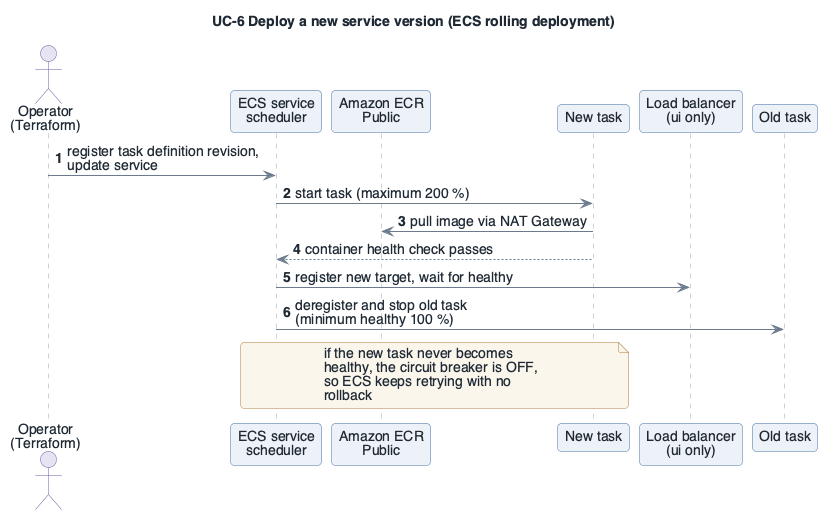

# View: Runtime services  (Component-and-Connector / service-oriented + publish-subscribe)

- **Viewtype**: Component-and-Connector
- **Style**: service-oriented (synchronous HTTP via ECS Service Connect), shared-nothing data per service, publish-subscribe for order events
- **Stakeholders / concerns addressed**: ST-2 architect (what runs and how it interacts), ST-3 operator (failure paths), ST-4 security (data flows carrying PII), ST-5 shopper journeys ([UC-1](../drivers/use-cases/UC-1.md)–[UC-5](../drivers/use-cases/UC-5.md))
- **Date**: 2026-10-09

The view has three presentations (each ≤ 10 elements): the service interaction, the catalogue/cart
data paths, and the checkout/order data paths.

## 1. Primary presentation

### 1a. Service interaction

Source: [`diagrams/view-cnc-services.puml`](diagrams/view-cnc-services.puml) · UML, rendered with PlantUML · visually verified

### 1b. Catalogue and cart data paths

Source: [`diagrams/view-cnc-catalog-carts.puml`](diagrams/view-cnc-catalog-carts.puml) · UML, rendered with PlantUML · visually verified

### 1c. Checkout and order data paths

Source: [`diagrams/view-cnc-checkout-orders.puml`](diagrams/view-cnc-checkout-orders.puml) · UML, rendered with PlantUML · visually verified

_visually verified: yes · relative path renders on GitHub / GitLab_

Legend: [diagrams/legend.png](diagrams/legend.png)

## 2. Element catalog

### 2.1 Elements and their properties

| Element | Responsibility / role | Key properties |
|---------|-----------------------|----------------|
| Application Load Balancer `retail-store-ecs-ui` | Single public entry point | internet-facing, 3 Availability Zones, listener HTTP:80 → target group `ui-application` (HTTP 8080, ip targets, health `/actuator/health` = 200); access logs off; deletion protection off |
| ui | Storefront | 1 task, 1 vCPU / 2 GB, Service Connect name `ui` |
| catalog | Product API + search | 1 task; secrets: database and OpenSearch credentials |
| carts | Cart API | 1 task; task role `dynamodb:*` on its table |
| checkout | Checkout orchestration | 1 task; Redis URL in plain environment variable |
| orders | Order API + event publisher | 1 task; secrets: database and broker credentials |
| Aurora MySQL `retail-store-ecs-catalog` | Catalogue system of record | 8.0.mysql_aurora.3.10.3; 1 writer, no reader; encrypted; backups 7 days |
| OpenSearch `retail-store-ecs-catalog` | Product search index | 3.3; 1 × `r8g.medium.search`; VPC; encryption at rest + node-to-node; HTTPS enforced |
| DynamoDB `retail-store-ecs-carts` | Cart store | on-demand; key `id`, GSI `idx_global_customerId`; point-in-time recovery off |
| ElastiCache `retail-store-ecs-checkout` | Checkout session store | Redis 4.0.10; 1 node; no failover; no encryption in transit or at rest; no AUTH |
| Aurora PostgreSQL `retail-store-ecs-orders` | Order system of record | 15.10; 1 writer, no reader; encrypted; backups 7 days |
| Amazon MQ `retail-store-ecs-orders-broker` | Order event broker | RabbitMQ 3.13.7; `SINGLE_INSTANCE`; private; AWS-owned key; general logs off |

### 2.2 Relations and their properties

| From | Connector | To | Properties |
|------|-----------|----|-----------|
| Shopper | HTTP | Load balancer | port 80, plaintext; security group open to 0.0.0.0/0 |
| Load balancer | HTTP | ui | 8080; idle timeout 60 s |
| ui, checkout | Service Connect (HTTP through the Envoy sidecar ECS injects) | catalog, carts, checkout, orders | alias `http://<name>` port 80 → container 8080; namespace `retailstore.local`; **no TLS** configured; synchronous |
| catalog | MySQL protocol | Aurora MySQL | TCP 3306; `require_secure_transport` off |
| catalog | HTTPS REST | OpenSearch | 443; TLS 1.2 policy; internal user database |
| carts | AWS SDK over HTTPS | DynamoDB | regional public endpoint via the single NAT Gateway (no gateway endpoint) |
| checkout | Redis protocol | ElastiCache | TCP 6379; plaintext, unauthenticated |
| orders | PostgreSQL protocol | Aurora PostgreSQL | TCP 5432; `rds.force_ssl=0` |
| orders | AMQP 0-9-1 over TLS | Amazon MQ | AMQPS 5671; publish-subscribe, asynchronous |

### 2.3 Element interfaces

Interfaces are the upstream HTTP/JSON APIs on port 8080 and the store protocols above. Agreement
points visible from the deployment:

- **Scope / interaction style**: request-response over HTTP between services; asynchronous publish for
  order events.
- **Data representation**: JSON (application APIs); provider-native protocols to the stores.
- **Error model**: health endpoints `/health` (catalog, checkout) and `/actuator/health` (ui, carts, orders)
  are the only error contract the platform uses; retries/timeouts are inside the images and not visible.

### 2.4 Element behavior

One sequence per architecturally significant use case.

#### UC-1 / UC-2 — Browse and search the catalogue

Source: [`diagrams/seq-uc1-browse.puml`](diagrams/seq-uc1-browse.puml) · UML, rendered with PlantUML · visually verified

The load balancer passes the request to the single `ui` task, which asks `catalog` through the
Service Connect alias. `catalog` reads products from Aurora MySQL; when the shopper searches, it
queries the OpenSearch `products` index instead. Every hop is synchronous, so the page fails if any of
`ui`, `catalog` or the store is unavailable ([AQA-1](../drivers/quality-attributes/AQA-1.md), [PQA-1](../drivers/quality-attributes/PQA-1.md)).

#### UC-3 — Manage shopping cart

Source: [`diagrams/seq-uc3-cart.puml`](diagrams/seq-uc3-cart.puml) · UML, rendered with PlantUML · visually verified

`carts` is the only service that talks to a regional AWS data endpoint. With no DynamoDB gateway
endpoint in the VPC, the call leaves through the one NAT Gateway in eu-central-1a — tasks in 1b and
1c cross Availability Zones to reach it, and losing 1a stops all cart writes ([AQA-2](../drivers/quality-attributes/AQA-2.md)).

#### UC-4 / UC-5 — Check out and place order

Source: [`diagrams/seq-uc4-checkout.puml`](diagrams/seq-uc4-checkout.puml) · UML, rendered with PlantUML · visually verified

Checkout state lives only in the single Redis node; the order is written to Aurora PostgreSQL and an
event is published asynchronously to RabbitMQ. Shopper PII crosses four plaintext hops on the way
(load balancer, Service Connect, Redis, PostgreSQL) — the core of [SQA-1](../drivers/quality-attributes/SQA-1.md).
What `orders` does when the publish fails after the insert is decided inside the image ([CON-3](../drivers/constraints/CON-3.md)).

#### UC-6 — Deploy a new service version

Source: [`diagrams/seq-uc6-deploy.puml`](diagrams/seq-uc6-deploy.puml) · UML, rendered with PlantUML · visually verified

The rolling configuration keeps the old task until the new one is healthy, so a good release causes no
downtime. A bad release is never rolled back automatically, and the image pull depends on the public
registry and the NAT Gateway ([DQA-1](../drivers/quality-attributes/DQA-1.md)).

[UC-7](../drivers/use-cases/UC-7.md) (diagnose) is an operator interaction with CloudWatch and ECS
Exec rather than a runtime path between components; it is documented in the
[observability view](view-observability.md).

## 3. Context diagram

The runtime system's context is the [system context](system-overview.md#context): shoppers and
operators outside, ECR Public, AWS regional services and (future) order consumers as external systems.

## 4. Variability guide

| Variation point | How to exercise it |
|-----------------|--------------------|
| Task count per service | `desiredCount` of each ECS service (currently 1; no auto scaling configured) |
| Search path | `RETAIL_UI_SEARCH_ENABLED` / `RETAIL_CATALOG_SEARCH_ENABLED` turn the OpenSearch path on or off |
| Store providers | `RETAIL_*_PROVIDER` variables ([MQA-1](../drivers/quality-attributes/MQA-1.md)) |
| Service Connect TLS | can be enabled per service with a private certificate authority (not used) |

## 5. Rationale

- **Synchronous HTTP via Service Connect** gives service discovery and load balancing without an
  internal load balancer and keeps the call graph simple (one interaction pattern) — serving
  [BG-1](../drivers/business-goals/BG-1.md). The price is a chain of synchronous dependencies:
  availability of a journey is the product of the availability of every service in it
  ([AQA-1](../drivers/quality-attributes/AQA-1.md)).
- **Database per service** isolates failures and schema change to one owner
  ([MQA-1](../drivers/quality-attributes/MQA-1.md), [SQA-2](../drivers/quality-attributes/SQA-2.md)) and lets each
  service demonstrate a different managed store ([BG-1](../drivers/business-goals/BG-1.md), [CON-4](../drivers/constraints/CON-4.md)).
- **Publish-subscribe for orders** decouples future consumers from `orders`
  ([INQA-1](../drivers/quality-attributes/INQA-1.md)).
- **Single instances everywhere** keep cost low ([BG-3](../drivers/business-goals/BG-3.md)) at the
  direct expense of [AQA-1](../drivers/quality-attributes/AQA-1.md) and [AQA-2](../drivers/quality-attributes/AQA-2.md) —
  analysed in the [ATAM](../atam/atam-report.md).

---

**Navigation**: [docs roadmap](README.md) · [architecture package](../README.md)
