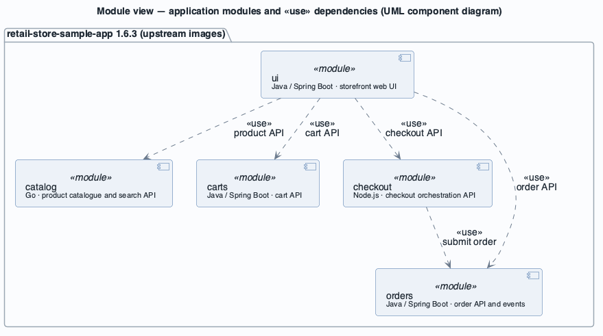
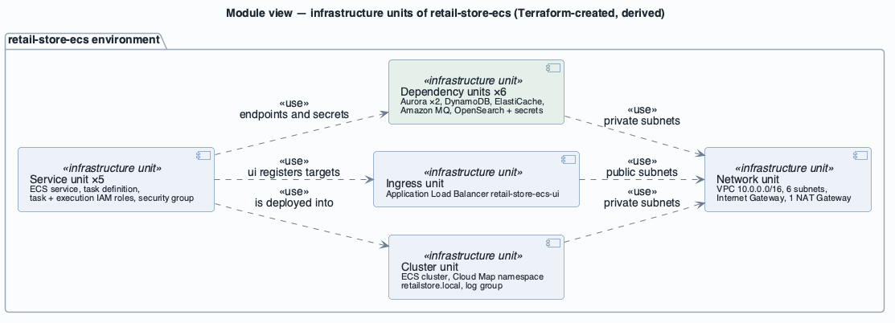

# View: Module decomposition and uses  (Module / decomposition + uses)

- **Viewtype**: Module
- **Style**: decomposition, overlaid with uses
- **Stakeholders / concerns addressed**: ST-2 architect and ST-6 upstream maintainers (what the units are, what depends on what), ST-3 operator (impact of changing or upgrading one unit), future architect
- **Date**: 2026-10-09

The code is not owned ([CON-3](../drivers/constraints/CON-3.md)): the application modules are the five
upstream images, and the infrastructure modules are reconstructed from resource naming and tags. Two
presentations follow — the application modules with their *uses* dependencies, and the infrastructure
units that host them.

## 1. Primary presentation

### 1a. Application modules (upstream images, release 1.6.3) — uses

Source: [`diagrams/view-module-application.puml`](diagrams/view-module-application.puml) · UML, rendered with PlantUML · visually verified

### 1b. Infrastructure units (reconstructed from names and tags)

Source: [`diagrams/view-module-infrastructure.puml`](diagrams/view-module-infrastructure.puml) · UML, rendered with PlantUML · visually verified

_visually verified: yes · relative path renders on GitHub / GitLab_

Legend: [diagrams/legend.png](diagrams/legend.png)

## 2. Element catalog

### 2.1 Elements and their properties

| Element | Responsibility / role | Key properties |
|---------|-----------------------|----------------|
| ui | Server-rendered storefront; aggregates the other four APIs | image `retail-store-sample-ui:1.6.3`; health `/actuator/health`; search feature flag |
| catalog | Product catalogue and search | image `retail-store-sample-catalog:1.6.3`; health `/health`; providers: MySQL (persistence), OpenSearch (search) |
| carts | Shopping cart per customer | image `retail-store-sample-cart:1.6.3`; provider DynamoDB |
| checkout | Holds in-progress checkout; submits orders | image `retail-store-sample-checkout:1.6.3`; health `/health`; provider Redis |
| orders | Stores orders; publishes order events | image `retail-store-sample-orders:1.6.3`; providers PostgreSQL + RabbitMQ |
| Network unit | Addressing, routing, egress | 3 public + 3 private /24 subnets over eu-central-1a/b/c; one NAT Gateway |
| Cluster unit | Run-time platform and discovery | Container Insights `enhanced`; Service Connect namespace `retailstore.local` |
| Ingress unit | Public entry point | internet-facing; HTTP:80 listener only |
| Service unit (×5) | One deployable per application module | 1 vCPU / 2 GB, `desiredCount 1`, ECS Exec on, own security group and roles |
| Dependency units (×6) | Each module's private data store(s) | see [deployment view](view-allocation-deployment.md) |

### 2.2 Relations and their properties

| From | Relation | To | Properties |
|------|----------|----|-----------|
| ui | uses | catalog, carts, checkout, orders | bound by environment variables `RETAIL_UI_ENDPOINTS_*` = `http://<name>` |
| checkout | uses | orders | `RETAIL_CHECKOUT_ENDPOINTS_ORDERS=http://orders` |
| Service unit | depends on | Dependency unit | endpoint in environment variables, credentials as Secrets Manager references |
| every unit | is part of | retail-store-ecs environment | tag `environment-name=retail-store-ecs` (load balancer, cluster, task definitions untagged) |

No module uses another module's data store: **each data store has exactly one owning module** (data
ownership per service).

### 2.3 Element interfaces

| Module | Provided interface | Required interfaces |
|--------|--------------------|---------------------|
| catalog | HTTP/JSON product API on 8080 (Service Connect alias `catalog:80`) | MySQL protocol; OpenSearch REST over HTTPS |
| carts | HTTP/JSON cart API on 8080 (`carts:80`) | DynamoDB API over HTTPS |
| checkout | HTTP/JSON checkout API on 8080 (`checkout:80`) | Redis protocol; orders API |
| orders | HTTP/JSON order API on 8080 (`orders:80`); AMQP order events | PostgreSQL protocol; AMQP 0-9-1 over TLS |
| ui | HTML over HTTP on 8080 | the four APIs above |

The exact API contracts belong to the upstream project; they are not reconstructed here.

### 2.4 Element behavior

Behaviour is documented in the [C&C runtime view](view-cnc-runtime.md#24-element-behavior).

## 3. Context diagram

The module set is bounded by the five images and their infrastructure; the context is in the
[system overview](system-overview.md#context).

## 4. Variability guide

| Variation point | Binding time | How to exercise it |
|-----------------|--------------|--------------------|
| Persistence / messaging provider per module | deployment (environment variables) | change `RETAIL_*_PERSISTENCE_PROVIDER`, `RETAIL_ORDERS_MESSAGING_PROVIDER` in the task definition, within the providers the image supports ([MQA-1](../drivers/quality-attributes/MQA-1.md), [CON-4](../drivers/constraints/CON-4.md)) |
| Search on/off | deployment | `RETAIL_UI_SEARCH_ENABLED`, `RETAIL_CATALOG_SEARCH_ENABLED` |
| Service endpoints | deployment | `RETAIL_UI_ENDPOINTS_*`, `RETAIL_CHECKOUT_ENDPOINTS_ORDERS` |
| Application version | deployment | image tag in the task definition (currently pinned to 1.6.3 for all five) |

## 5. Rationale

- **Service per business capability with private data** keeps modules independently deployable and
  lets each exercise a different managed service — serving [BG-1](../drivers/business-goals/BG-1.md) and
  [MQA-1](../drivers/quality-attributes/MQA-1.md). Consequence: the shopping journey depends on five
  services being up at once ([AQA-1](../drivers/quality-attributes/AQA-1.md)).
- **Configuration-time binding** of providers and endpoints is the main modifiability tactic and the
  only one available to this deployment, because code changes are out of scope ([CON-3](../drivers/constraints/CON-3.md)).
- The infrastructure decomposition mirrors the application modules one-to-one, which makes ownership
  clear but multiplies per-service settings that must be kept consistent (e.g. all five security groups
  share the same overly broad ingress rule — [SQA-2](../drivers/quality-attributes/SQA-2.md)).

---

**Navigation**: [docs roadmap](README.md) · [architecture package](../README.md)
