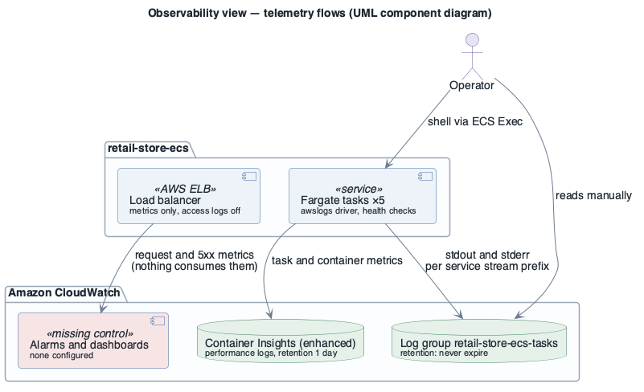
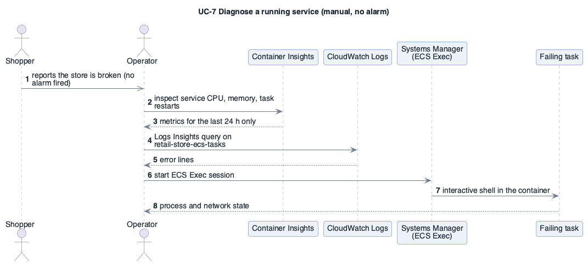

# View: Observability  (quality view — Component-and-Connector / telemetry)

- **Viewtype**: quality view (observability), C&C telemetry flows
- **Style**: telemetry pipeline
- **Stakeholders / concerns addressed**: ST-3 operator (detect, diagnose — [UC-7](../drivers/use-cases/UC-7.md)), [OQA-1](../drivers/quality-attributes/OQA-1.md), [PQA-2](../drivers/quality-attributes/PQA-2.md)
- **Date**: 2026-10-09

## 1. Primary presentation

Source: [`diagrams/view-observability.puml`](diagrams/view-observability.puml) · UML, rendered with PlantUML · visually verified

_visually verified: yes · relative path renders on GitHub / GitLab_

Legend: [diagrams/legend.png](diagrams/legend.png)

## 2. Element catalog

### 2.1 Elements and their properties

| Element | Role | As-built properties |
|---------|------|---------------------|
| Log group `retail-store-ecs-tasks` | Application logs of all services | one group, stream prefix `<service>-service`; no retention set; no KMS key |
| Container Insights (enhanced) | Cluster/service/task metrics | `/aws/ecs/containerinsights/retail-store-ecs-cluster/performance`, retention 1 day |
| Load balancer metrics | Request count, latency, 5xx | available in CloudWatch; no alarm consumes them |
| Alarms, dashboards | Detection and overview | **0** for this workload |
| Amazon MQ logs | Broker diagnostics | general logs **off** |
| Aurora logs | Database diagnostics | no log exports; Performance Insights off; Enhanced Monitoring off |
| Tracing | Request correlation | none configured |

### 2.2 Relations and their properties

| From | Relation | To | Properties |
|------|----------|----|-----------|
| Tasks | write logs | `retail-store-ecs-tasks` | awslogs driver, region eu-central-1 |
| Cluster | emits metrics | Container Insights | enhanced observability |
| Operator | reads | CloudWatch, ECS Exec | manual; nothing pushes a notification |

### 2.3 Element interfaces

CloudWatch Logs Insights and the metrics API are the operator's only interfaces; there is no
notification interface (no SNS topic, no on-call integration).

### 2.4 Element behavior

Source: [`diagrams/seq-uc7-diagnose.puml`](diagrams/seq-uc7-diagnose.puml) · UML, rendered with PlantUML · visually verified

The trigger is a shopper, not a monitor. The operator works backwards through Container Insights (one
day of history), the shared log group and, if needed, a shell opened with ECS Exec — the only
diagnostic path the deployment provides for [UC-7](../drivers/use-cases/UC-7.md).

**A service starts failing** ([OQA-1](../drivers/quality-attributes/OQA-1.md)): the container health
check fails, ECS replaces the task and logs a service event; the load balancer's 5xx metric rises. Nothing
notifies anyone — the first signal is a shopper report. The operator then follows
[UC-7](../drivers/use-cases/UC-7.md); evidence older than one day is already gone from Container Insights.

## 3. Context diagram

Telemetry stays inside CloudWatch in eu-central-1; no external monitoring system is connected
([system context](system-overview.md#context)).

## 4. Variability guide

| Variation point | How to exercise it |
|-----------------|--------------------|
| Log retention | `retention_in_days` on both log groups |
| Alarms | CloudWatch alarms on load balancer 5xx / unhealthy hosts, ECS running-task count, Aurora/Redis/MQ health → SNS |
| Tracing | AWS Distro for OpenTelemetry sidecar (the upstream app supports OpenTelemetry — confirm with ST-6) |

## 5. Rationale

Collection exists (logs + enhanced Container Insights), detection does not. That gap is what fails
[OQA-1](../drivers/quality-attributes/OQA-1.md) and leaves [PQA-2](../drivers/quality-attributes/PQA-2.md)
without data beyond 24 hours; it also conflicts with [BG-4](../drivers/business-goals/BG-4.md).

---

**Navigation**: [docs roadmap](README.md) · [architecture package](../README.md)
