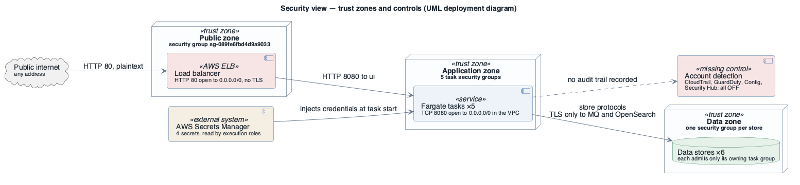
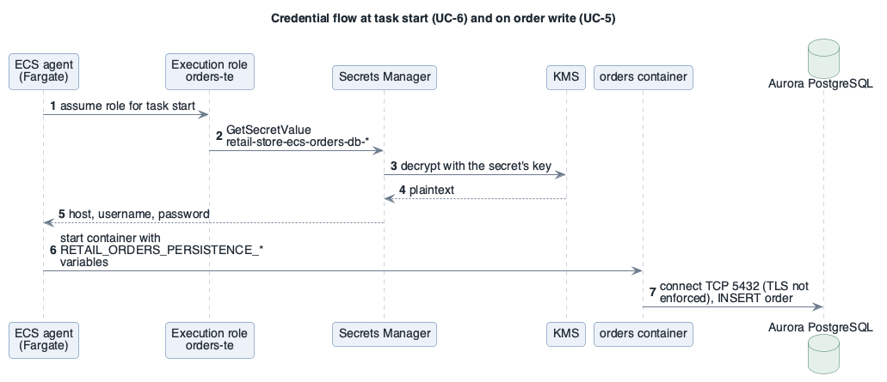

# View: Security  (quality view — Component-and-Connector + Allocation overlay)

- **Viewtype**: quality view (security), combining C&C data flows with network zones
- **Style**: trust zones, security-group connectors, identity and secrets
- **Stakeholders / concerns addressed**: ST-4 security (exposure, data protection, least privilege, detection), ST-1 owner (risk of exposing a shared account), [SQA-1](../drivers/quality-attributes/SQA-1.md), [SQA-2](../drivers/quality-attributes/SQA-2.md), [SQA-3](../drivers/quality-attributes/SQA-3.md)
- **Date**: 2026-10-09

Security is a pervasive concern spread over the network, runtime and identity structures, so it gets its
own view.

## 1. Primary presentation

Source: [`diagrams/view-security-zones.puml`](diagrams/view-security-zones.puml) · UML, rendered with PlantUML · visually verified

_visually verified: yes · relative path renders on GitHub / GitLab_

Legend: [diagrams/legend.png](diagrams/legend.png) — red marks a control that is missing or weak.

## 2. Element catalog

### 2.1 Elements and their properties

| Element | Security role | As-built properties |
|---------|---------------|---------------------|
| Load balancer security groups | Public exposure | `sg-089fe6fbd4d9a9033`: inbound TCP 80 from 0.0.0.0/0, outbound all; `sg-0796835a07e6dc412`: no rules (attached, unused) |
| Task security groups (ui, catalog, carts, checkout, orders) | East-west control | each: inbound TCP 8080 from **0.0.0.0/0**, outbound all — reachable from anything in the VPC |
| Store security groups | Data-zone control | MySQL 3306 ← catalog-task; PostgreSQL 5432 ← orders-task; RabbitMQ 5671 ← orders-task; Redis 6379 ← checkout-task; OpenSearch 443 ← catalog-task — **correctly scoped** |
| Task IAM roles (×5) | Runtime permissions | ECS Exec (`ssmmessages:*`), CloudWatch Logs write; carts: `dynamodb:*` on its table; **checkout: also `dynamodb:*` on the carts table (unused)** |
| Execution IAM roles (×5) | Start-up permissions | `AmazonECSTaskExecutionRolePolicy`; catalog and orders: `secretsmanager:GetSecretValue` + `kms:Decrypt*` on **their own** secrets only |
| Secrets | Credentials | `retail-store-ecs-catalog-db-*`, `-catalog-opensearch-*` (customer KMS key), `-orders-db-*`, `-mq-*` (AWS-managed key); rotation not enabled |
| Encryption at rest | Data protection | Aurora ×2 yes; OpenSearch yes (KMS); DynamoDB AWS-owned key; MQ AWS-owned key; **Redis no** |
| Encryption in transit | Data protection | AMQPS and OpenSearch HTTPS yes; **load balancer, Service Connect, Redis, Aurora not enforced** |
| Detection | Accountability | no CloudTrail trail, GuardDuty off, Security Hub off, Config not recording, no VPC Flow Logs, no load balancer access logs |

### 2.2 Relations and their properties

| From | Relation | To | Properties |
|------|----------|----|-----------|
| Internet | may connect | Load balancer | TCP 80 only |
| Any VPC address | may connect | every task | TCP 8080 (should be: load balancer → ui; ui → others; checkout → orders) |
| Owning task | may connect | its store | one rule per store |
| Execution role | reads | its secrets | at task start; values become container environment variables |
| Operator | may open a shell in | any task | ECS Exec enabled on all five services |

### 2.3 Element interfaces

The externally reachable interface is HTTP 80 on the load balancer. No WAF, no authentication at the
edge; the application's own sign-in is a demonstration feature of the upstream UI.

### 2.4 Element behavior

Source: [`diagrams/seq-security-credentials.puml`](diagrams/seq-security-credentials.puml) · UML, rendered with PlantUML · visually verified

Credentials never sit in the task definition: the execution role fetches them when a task starts
during a deployment ([UC-6](../drivers/use-cases/UC-6.md)) and they become environment variables
inside the container. From there they are visible to anyone with ECS Exec access to that task, and
the database connection that uses them in [UC-5](../drivers/use-cases/UC-5.md) is not required to be
encrypted.

**Compromised `ui` task** ([SQA-2](../drivers/quality-attributes/SQA-2.md)): it can call every other service
on 8080 (allowed by design for catalog/carts/checkout/orders) but cannot reach any data store directly — the
store security groups stop it. It cannot read the catalog/orders secrets (other execution roles). It can
use its task role for CloudWatch Logs only. Lateral movement is therefore limited to the application APIs.
**Compromised `checkout` task**: can additionally read and modify every cart in DynamoDB (excess `dynamodb:*`)
and read all checkout sessions in the unauthenticated Redis.

## 3. Context diagram

The trust boundary of interest is the AWS account: it is shared with unrelated workloads and their
IAM users (2 without MFA, no password policy) — see the [system context](system-overview.md#context) and
[AC-1](../drivers/concerns/AC-1.md), [AC-3](../drivers/concerns/AC-3.md).

## 4. Variability guide

| Variation point | How to exercise it |
|-----------------|--------------------|
| Edge TLS | add an HTTPS:443 listener with an ACM certificate; redirect 80 → 443 |
| Service-to-service TLS | Service Connect TLS with AWS Private CA |
| Task ingress | replace `0.0.0.0/0` with source security groups per caller |
| ECS Exec | `enableExecuteCommand` per service |

## 5. Rationale

Per-store security groups and per-service secrets show deliberate least-privilege design for the data
zone — a non-risk for [SQA-2](../drivers/quality-attributes/SQA-2.md) under the assumption that the
store credentials stay scoped. The edge and the application zone were left open, consistent with a
demonstration intent ([CON-5](../drivers/constraints/CON-5.md)) but in conflict with
[BG-4](../drivers/business-goals/BG-4.md), [SQA-1](../drivers/quality-attributes/SQA-1.md) and
[SQA-3](../drivers/quality-attributes/SQA-3.md).

---

**Navigation**: [docs roadmap](README.md) · [architecture package](../README.md)
