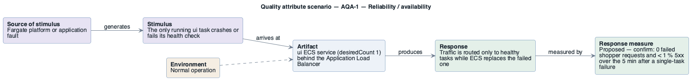

# AQA-1: Single task failure of the storefront

- **Status**: at risk
- **Source**: authored here by `/drivers` (register mode) during the brownfield reconstruction

> **Derived — confirm.** Reconstructed from the deployed AWS environment (read-only evidence), not from a stakeholder. Treat as a hypothesis until confirmed. The response measure is a **proposed straw-man target** to bracket the discussion with the stakeholders — no SLO, alarm threshold or contract exists in the deployment to harvest one from.

| Part | Value |
|------|-------|
| **ID** | AQA-1 |
| **ISO/IEC 25010 characteristic** | Reliability |
| **Sub-characteristic** | availability |
| **Source of stimulus** | Fargate platform or application fault |
| **Stimulus** | The only running `ui` task crashes or fails its health check |
| **Artifact** | `ui` ECS service (desiredCount 1) behind the Application Load Balancer |
| **Environment** | Normal operation |
| **Response** | Traffic is routed only to healthy tasks while ECS replaces the failed one |
| **Response measure** | Proposed — confirm: 0 failed shopper requests and < 1 % 5xx over the 5 min after a single-task failure |
| **Business goals supported** | BG-2, BG-4 |
| **Priority** | Importance = H · Difficulty = M |
| **Candidate tactics** | *Availability — detect faults*: health check (present), monitor; *recover from faults*: redundant spare (active, ≥ 2 tasks across Availability Zones), rollback. |
| **Type** | concrete |

## As-built evidence

Every service runs `desiredCount 1`. A task failure makes that function unavailable until a replacement passes health checks (target group `ui-application`: path `/actuator/health`, matcher 200). For `ui` this is a total storefront outage.

Evidence: [`aws/scoped/retail-store-ecs-evidence.json`](../../../aws/scoped/retail-store-ecs-evidence.json), [`aws/well-architected/well-architected-findings.md`](../../../aws/well-architected/well-architected-findings.md).

## Six-part scenario diagram

SEI six-part quality attribute scenario notation (no UML diagram type exists for it), drawn with PlantUML in the package's UML palette.

Source: [`diagrams/scenario-AQA-1.puml`](diagrams/scenario-AQA-1.puml) · rendered with PlantUML · visually verified: yes
