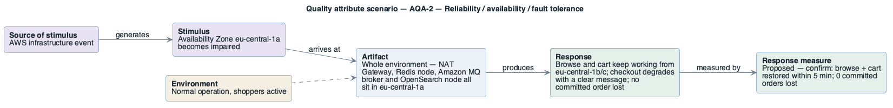

# AQA-2: Loss of Availability Zone eu-central-1a

- **Status**: at risk
- **Source**: authored here by `/drivers` (register mode) during the brownfield reconstruction

> **Derived — confirm.** Reconstructed from the deployed AWS environment (read-only evidence), not from a stakeholder. Treat as a hypothesis until confirmed. The response measure is a **proposed straw-man target** to bracket the discussion with the stakeholders — no SLO, alarm threshold or contract exists in the deployment to harvest one from.

| Part | Value |
|------|-------|
| **ID** | AQA-2 |
| **ISO/IEC 25010 characteristic** | Reliability |
| **Sub-characteristic** | availability / fault tolerance |
| **Source of stimulus** | AWS infrastructure event |
| **Stimulus** | Availability Zone eu-central-1a becomes impaired |
| **Artifact** | Whole environment — NAT Gateway, Redis node, Amazon MQ broker and OpenSearch node all sit in eu-central-1a |
| **Environment** | Normal operation, shoppers active |
| **Response** | Browse and cart keep working from eu-central-1b/c; checkout degrades with a clear message; no committed order lost |
| **Response measure** | Proposed — confirm: browse + cart restored within 5 min; 0 committed orders lost |
| **Business goals supported** | BG-2, BG-4 |
| **Priority** | Importance = H · Difficulty = H |
| **Candidate tactics** | *Availability — recover from faults*: redundant spare (Multi-AZ Aurora, Redis replica with automatic failover, Amazon MQ cluster deployment, OpenSearch zone awareness), one NAT Gateway per Availability Zone; *prevent faults*: removal from service. |
| **Type** | concrete |

## As-built evidence

The data tier is single-AZ: both Aurora writers in 1c, Redis, MQ and OpenSearch in 1a; the only NAT Gateway is in 1a and serves the private subnets of all three Availability Zones. Loss of 1a removes egress for every task (DynamoDB, ECR Public, Secrets Manager, CloudWatch Logs) plus checkout, order events and search.

Evidence: [`aws/scoped/retail-store-ecs-evidence.json`](../../../aws/scoped/retail-store-ecs-evidence.json), [`aws/well-architected/well-architected-findings.md`](../../../aws/well-architected/well-architected-findings.md).

## Six-part scenario diagram

SEI six-part quality attribute scenario notation (no UML diagram type exists for it), drawn with PlantUML in the package's UML palette.

Source: [`diagrams/scenario-AQA-2.puml`](diagrams/scenario-AQA-2.puml) · rendered with PlantUML · visually verified: yes
