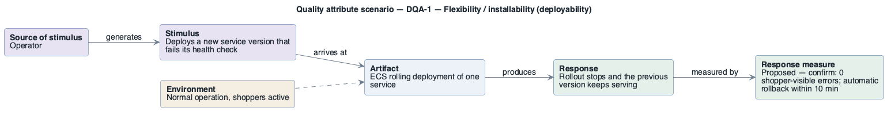

# DQA-1: Safe rollout of a bad version

- **Status**: at risk
- **Source**: authored here by `/drivers` (register mode) during the brownfield reconstruction

> **Derived — confirm.** Reconstructed from the deployed AWS environment (read-only evidence), not from a stakeholder. Treat as a hypothesis until confirmed. The response measure is a **proposed straw-man target** to bracket the discussion with the stakeholders — no SLO, alarm threshold or contract exists in the deployment to harvest one from.

| Part | Value |
|------|-------|
| **ID** | DQA-1 |
| **ISO/IEC 25010 characteristic** | Flexibility |
| **Sub-characteristic** | installability (deployability) |
| **Source of stimulus** | Operator |
| **Stimulus** | Deploys a new service version that fails its health check |
| **Artifact** | ECS rolling deployment of one service |
| **Environment** | Normal operation, shoppers active |
| **Response** | Rollout stops and the previous version keeps serving |
| **Response measure** | Proposed — confirm: 0 shopper-visible errors; automatic rollback within 10 min |
| **Business goals supported** | BG-1, BG-4 |
| **Priority** | Importance = M · Difficulty = L |
| **Candidate tactics** | *Deployability — manage deployment pipeline*: scale rollouts, roll back; *Availability*: canary / blue-green. |
| **Type** | concrete |

## As-built evidence

Rolling, minimum healthy 100 % / maximum 200 % (old task kept until the new one is healthy). Deployment circuit breaker **disabled** (`enable: false, rollback: false`), so a failing version is retried indefinitely without rollback; bake time 0.

Evidence: [`aws/scoped/retail-store-ecs-evidence.json`](../../../aws/scoped/retail-store-ecs-evidence.json), [`aws/well-architected/well-architected-findings.md`](../../../aws/well-architected/well-architected-findings.md).

## Six-part scenario diagram

SEI six-part quality attribute scenario notation (no UML diagram type exists for it), drawn with PlantUML in the package's UML palette.

Source: [`diagrams/scenario-DQA-1.puml`](diagrams/scenario-DQA-1.puml) · rendered with PlantUML · visually verified: yes
