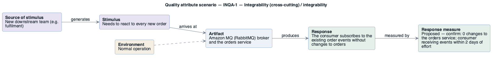

# INQA-1: Add a consumer of order events

- **Status**: addressed
- **Source**: authored here by `/drivers` (register mode) during the brownfield reconstruction

> **Derived — confirm.** Reconstructed from the deployed AWS environment (read-only evidence), not from a stakeholder. Treat as a hypothesis until confirmed. The response measure is a **proposed straw-man target** to bracket the discussion with the stakeholders — no SLO, alarm threshold or contract exists in the deployment to harvest one from.

| Part | Value |
|------|-------|
| **ID** | INQA-1 |
| **ISO/IEC 25010 characteristic** | Integrability (cross-cutting) |
| **Sub-characteristic** | integrability |
| **Source of stimulus** | New downstream team (e.g. fulfilment) |
| **Stimulus** | Needs to react to every new order |
| **Artifact** | Amazon MQ (RabbitMQ) broker and the orders service |
| **Environment** | Normal operation |
| **Response** | The consumer subscribes to the existing order events without changes to `orders` |
| **Response measure** | Proposed — confirm: 0 changes to the orders service; consumer receiving events within 2 days of effort |
| **Business goals supported** | BG-1 |
| **Priority** | Importance = M · Difficulty = L |
| **Candidate tactics** | *Integrability — limit dependencies*: use an intermediary (message broker), publish-subscribe; *adapt*: tailor interface. |
| **Type** | concrete |

## As-built evidence

Present: `orders` publishes to RabbitMQ 3.13 on Amazon MQ over AMQPS 5671. The broker's security group admits only the orders task security group, so a new consumer needs a security-group rule and credentials.

Evidence: [`aws/scoped/retail-store-ecs-evidence.json`](../../../aws/scoped/retail-store-ecs-evidence.json), [`aws/well-architected/well-architected-findings.md`](../../../aws/well-architected/well-architected-findings.md).

## Six-part scenario diagram

SEI six-part quality attribute scenario notation (no UML diagram type exists for it), drawn with PlantUML in the package's UML palette.

Source: [`diagrams/scenario-INQA-1.puml`](diagrams/scenario-INQA-1.puml) · rendered with PlantUML · visually verified: yes
