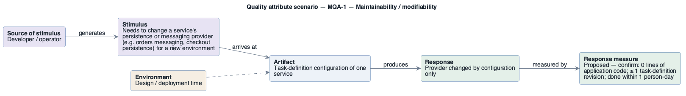

# MQA-1: Swap a backing-service provider

- **Status**: addressed
- **Source**: authored here by `/drivers` (register mode) during the brownfield reconstruction

> **Derived — confirm.** Reconstructed from the deployed AWS environment (read-only evidence), not from a stakeholder. Treat as a hypothesis until confirmed. The response measure is a **proposed straw-man target** to bracket the discussion with the stakeholders — no SLO, alarm threshold or contract exists in the deployment to harvest one from.

| Part | Value |
|------|-------|
| **ID** | MQA-1 |
| **ISO/IEC 25010 characteristic** | Maintainability |
| **Sub-characteristic** | modifiability |
| **Source of stimulus** | Developer / operator |
| **Stimulus** | Needs to change a service's persistence or messaging provider (e.g. orders messaging, checkout persistence) for a new environment |
| **Artifact** | Task-definition configuration of one service |
| **Environment** | Design / deployment time |
| **Response** | Provider changed by configuration only |
| **Response measure** | Proposed — confirm: 0 lines of application code; ≤ 1 task-definition revision; done within 1 person-day |
| **Business goals supported** | BG-1 |
| **Priority** | Importance = M · Difficulty = L |
| **Candidate tactics** | *Modifiability — defer binding*: configuration-time binding (environment variables), use an intermediary; *reduce coupling*: encapsulate. |
| **Type** | concrete |

## As-built evidence

Present: each service selects its provider through `RETAIL_*_PERSISTENCE_PROVIDER` / `RETAIL_ORDERS_MESSAGING_PROVIDER`, and endpoints/credentials are injected as environment variables and secrets. Limited to providers the images support (CON-4).

Evidence: [`aws/scoped/retail-store-ecs-evidence.json`](../../../aws/scoped/retail-store-ecs-evidence.json), [`aws/well-architected/well-architected-findings.md`](../../../aws/well-architected/well-architected-findings.md).

## Six-part scenario diagram

SEI six-part quality attribute scenario notation (no UML diagram type exists for it), drawn with PlantUML in the package's UML palette.

Source: [`diagrams/scenario-MQA-1.puml`](diagrams/scenario-MQA-1.puml) · rendered with PlantUML · visually verified: yes
