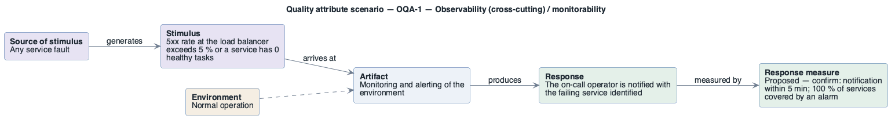

# OQA-1: Operators learn of failures before shoppers

- **Status**: at risk
- **Source**: authored here by `/drivers` (register mode) during the brownfield reconstruction

> **Derived — confirm.** Reconstructed from the deployed AWS environment (read-only evidence), not from a stakeholder. Treat as a hypothesis until confirmed. The response measure is a **proposed straw-man target** to bracket the discussion with the stakeholders — no SLO, alarm threshold or contract exists in the deployment to harvest one from.

| Part | Value |
|------|-------|
| **ID** | OQA-1 |
| **ISO/IEC 25010 characteristic** | Observability (cross-cutting) |
| **Sub-characteristic** | monitorability |
| **Source of stimulus** | Any service fault |
| **Stimulus** | 5xx rate at the load balancer exceeds 5 % or a service has 0 healthy tasks |
| **Artifact** | Monitoring and alerting of the environment |
| **Environment** | Normal operation |
| **Response** | The on-call operator is notified with the failing service identified |
| **Response measure** | Proposed — confirm: notification within 5 min; 100 % of services covered by an alarm |
| **Business goals supported** | BG-1, BG-4 |
| **Priority** | Importance = H · Difficulty = L |
| **Candidate tactics** | *Availability — detect faults*: monitor, heartbeat, exception detection; *Observability*: alarms with actions, dashboards, distributed tracing. |
| **Type** | concrete |

## As-built evidence

0 CloudWatch alarms and 0 dashboards for the workload; Container Insights (enhanced) metrics collected; task logs in `retail-store-ecs-tasks` with **no retention** (never expire); Amazon MQ general logs off; no tracing.

Evidence: [`aws/scoped/retail-store-ecs-evidence.json`](../../../aws/scoped/retail-store-ecs-evidence.json), [`aws/well-architected/well-architected-findings.md`](../../../aws/well-architected/well-architected-findings.md).

## Six-part scenario diagram

SEI six-part quality attribute scenario notation (no UML diagram type exists for it), drawn with PlantUML in the package's UML palette.

Source: [`diagrams/scenario-OQA-1.puml`](diagrams/scenario-OQA-1.puml) · rendered with PlantUML · visually verified: yes
