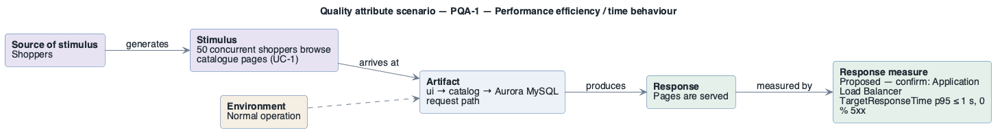

# PQA-1: Catalogue page responsiveness

- **Status**: open
- **Source**: authored here by `/drivers` (register mode) during the brownfield reconstruction

> **Derived — confirm.** Reconstructed from the deployed AWS environment (read-only evidence), not from a stakeholder. Treat as a hypothesis until confirmed. The response measure is a **proposed straw-man target** to bracket the discussion with the stakeholders — no SLO, alarm threshold or contract exists in the deployment to harvest one from.

| Part | Value |
|------|-------|
| **ID** | PQA-1 |
| **ISO/IEC 25010 characteristic** | Performance efficiency |
| **Sub-characteristic** | time behaviour |
| **Source of stimulus** | Shoppers |
| **Stimulus** | 50 concurrent shoppers browse catalogue pages (UC-1) |
| **Artifact** | ui → catalog → Aurora MySQL request path |
| **Environment** | Normal operation |
| **Response** | Pages are served |
| **Response measure** | Proposed — confirm: Application Load Balancer TargetResponseTime p95 ≤ 1 s, 0 % 5xx |
| **Business goals supported** | BG-1, BG-2 |
| **Priority** | Importance = M · Difficulty = M |
| **Candidate tactics** | *Performance — manage resources*: increase resources, introduce concurrency (more tasks), maintain multiple copies of data (read replica, cache); *control demand*: limit event response. |
| **Type** | concrete |

## As-built evidence

1 vCPU / 2 GB per task, one task per service, Aurora `db.t3.medium` (burstable CPU credits). No latency target, no load test results, no caching in front of the catalogue.

Evidence: [`aws/scoped/retail-store-ecs-evidence.json`](../../../aws/scoped/retail-store-ecs-evidence.json), [`aws/well-architected/well-architected-findings.md`](../../../aws/well-architected/well-architected-findings.md).

## Six-part scenario diagram

SEI six-part quality attribute scenario notation (no UML diagram type exists for it), drawn with PlantUML in the package's UML palette.

Source: [`diagrams/scenario-PQA-1.puml`](diagrams/scenario-PQA-1.puml) · rendered with PlantUML · visually verified: yes
