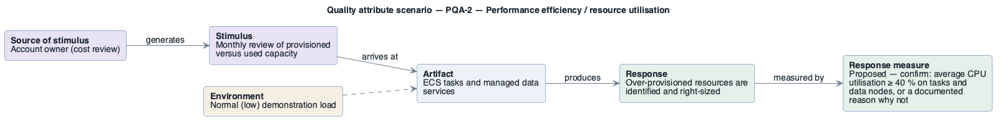

# PQA-2: Provisioned capacity is used

- **Status**: open
- **Source**: authored here by `/drivers` (register mode) during the brownfield reconstruction

> **Derived — confirm.** Reconstructed from the deployed AWS environment (read-only evidence), not from a stakeholder. Treat as a hypothesis until confirmed. The response measure is a **proposed straw-man target** to bracket the discussion with the stakeholders — no SLO, alarm threshold or contract exists in the deployment to harvest one from.

| Part | Value |
|------|-------|
| **ID** | PQA-2 |
| **ISO/IEC 25010 characteristic** | Performance efficiency |
| **Sub-characteristic** | resource utilisation |
| **Source of stimulus** | Account owner (cost review) |
| **Stimulus** | Monthly review of provisioned versus used capacity |
| **Artifact** | ECS tasks and managed data services |
| **Environment** | Normal (low) demonstration load |
| **Response** | Over-provisioned resources are identified and right-sized |
| **Response measure** | Proposed — confirm: average CPU utilisation ≥ 40 % on tasks and data nodes, or a documented reason why not |
| **Business goals supported** | BG-3 |
| **Priority** | Importance = M · Difficulty = L |
| **Candidate tactics** | *Performance — manage resources*: schedule resources, right-size; *Energy efficiency*: scale down / schedule off outside use. |
| **Type** | concrete |

## As-built evidence

Fixed sizes without utilisation data: 5 × (1 vCPU, 2 GB), `mq.m5.large`, `r8g.medium.search`, 2 × `db.t3.medium`. Container Insights (enhanced) collects the metrics but keeps performance logs 1 day only.

Evidence: [`aws/scoped/retail-store-ecs-evidence.json`](../../../aws/scoped/retail-store-ecs-evidence.json), [`aws/well-architected/well-architected-findings.md`](../../../aws/well-architected/well-architected-findings.md).

## Six-part scenario diagram

SEI six-part quality attribute scenario notation (no UML diagram type exists for it), drawn with PlantUML in the package's UML palette.

Source: [`diagrams/scenario-PQA-2.puml`](diagrams/scenario-PQA-2.puml) · rendered with PlantUML · visually verified: yes
