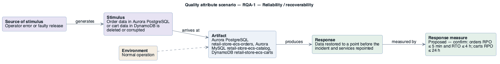

# RQA-1: Restore after data corruption or deletion

- **Status**: at risk
- **Source**: authored here by `/drivers` (register mode) during the brownfield reconstruction

> **Derived — confirm.** Reconstructed from the deployed AWS environment (read-only evidence), not from a stakeholder. Treat as a hypothesis until confirmed. The response measure is a **proposed straw-man target** to bracket the discussion with the stakeholders — no SLO, alarm threshold or contract exists in the deployment to harvest one from.

| Part | Value |
|------|-------|
| **ID** | RQA-1 |
| **ISO/IEC 25010 characteristic** | Reliability |
| **Sub-characteristic** | recoverability |
| **Source of stimulus** | Operator error or faulty release |
| **Stimulus** | Order data in Aurora PostgreSQL or cart data in DynamoDB is deleted or corrupted |
| **Artifact** | Aurora PostgreSQL `retail-store-ecs-orders`, Aurora MySQL `retail-store-ecs-catalog`, DynamoDB `retail-store-ecs-carts` |
| **Environment** | Normal operation |
| **Response** | Data restored to a point before the incident and services repointed |
| **Response measure** | Proposed — confirm: orders RPO ≤ 5 min and RTO ≤ 4 h; carts RPO ≤ 24 h |
| **Business goals supported** | BG-4 |
| **Priority** | Importance = H · Difficulty = M |
| **Candidate tactics** | *Availability — recover from faults*: rollback, state resynchronisation; backups with point-in-time recovery, AWS Backup with cross-region copy, deletion protection. |
| **Type** | concrete |

## As-built evidence

Aurora clusters: automated backups 7 days (point-in-time restore possible), deletion protection off. DynamoDB: point-in-time recovery **disabled**, deletion protection off. Redis: 0 snapshots. No AWS Backup plan; nothing copied out of region; restore never tested.

Evidence: [`aws/scoped/retail-store-ecs-evidence.json`](../../../aws/scoped/retail-store-ecs-evidence.json), [`aws/well-architected/well-architected-findings.md`](../../../aws/well-architected/well-architected-findings.md).

## Six-part scenario diagram

SEI six-part quality attribute scenario notation (no UML diagram type exists for it), drawn with PlantUML in the package's UML palette.

Source: [`diagrams/scenario-RQA-1.puml`](diagrams/scenario-RQA-1.puml) · rendered with PlantUML · visually verified: yes
