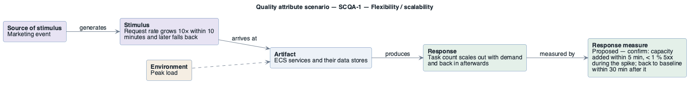

# SCQA-1: Demand spike

- **Status**: at risk
- **Source**: authored here by `/drivers` (register mode) during the brownfield reconstruction

> **Derived — confirm.** Reconstructed from the deployed AWS environment (read-only evidence), not from a stakeholder. Treat as a hypothesis until confirmed. The response measure is a **proposed straw-man target** to bracket the discussion with the stakeholders — no SLO, alarm threshold or contract exists in the deployment to harvest one from.

| Part | Value |
|------|-------|
| **ID** | SCQA-1 |
| **ISO/IEC 25010 characteristic** | Flexibility |
| **Sub-characteristic** | scalability |
| **Source of stimulus** | Marketing event |
| **Stimulus** | Request rate grows 10× within 10 minutes and later falls back |
| **Artifact** | ECS services and their data stores |
| **Environment** | Peak load |
| **Response** | Task count scales out with demand and back in afterwards |
| **Response measure** | Proposed — confirm: capacity added within 5 min, < 1 % 5xx during the spike; back to baseline within 30 min after it |
| **Business goals supported** | BG-2, BG-3 |
| **Priority** | Importance = M · Difficulty = H |
| **Candidate tactics** | *Performance — manage resources*: increase resources (ECS target-tracking auto scaling), maintain multiple copies; *control demand*: limit rates. |
| **Type** | concrete |

## As-built evidence

No Application Auto Scaling targets or policies for any service. DynamoDB on-demand scales; Aurora, Redis, MQ and OpenSearch are fixed single nodes.

Evidence: [`aws/scoped/retail-store-ecs-evidence.json`](../../../aws/scoped/retail-store-ecs-evidence.json), [`aws/well-architected/well-architected-findings.md`](../../../aws/well-architected/well-architected-findings.md).

## Six-part scenario diagram

SEI six-part quality attribute scenario notation (no UML diagram type exists for it), drawn with PlantUML in the package's UML palette.

Source: [`diagrams/scenario-SCQA-1.puml`](diagrams/scenario-SCQA-1.puml) · rendered with PlantUML · visually verified: yes
