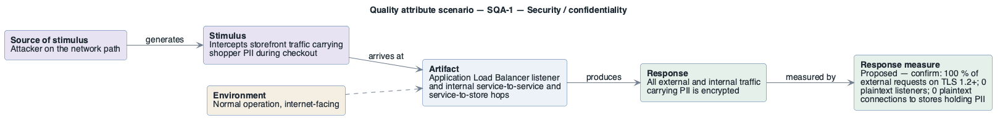

# SQA-1: Shopper traffic confidentiality in transit

- **Status**: at risk
- **Source**: authored here by `/drivers` (register mode) during the brownfield reconstruction

> **Derived — confirm.** Reconstructed from the deployed AWS environment (read-only evidence), not from a stakeholder. Treat as a hypothesis until confirmed. The response measure is a **proposed straw-man target** to bracket the discussion with the stakeholders — no SLO, alarm threshold or contract exists in the deployment to harvest one from.

| Part | Value |
|------|-------|
| **ID** | SQA-1 |
| **ISO/IEC 25010 characteristic** | Security |
| **Sub-characteristic** | confidentiality |
| **Source of stimulus** | Attacker on the network path |
| **Stimulus** | Intercepts storefront traffic carrying shopper PII during checkout |
| **Artifact** | Application Load Balancer listener and internal service-to-service and service-to-store hops |
| **Environment** | Normal operation, internet-facing |
| **Response** | All external and internal traffic carrying PII is encrypted |
| **Response measure** | Proposed — confirm: 100 % of external requests on TLS 1.2+; 0 plaintext listeners; 0 plaintext connections to stores holding PII |
| **Business goals supported** | BG-4 |
| **Priority** | Importance = H · Difficulty = L |
| **Candidate tactics** | *Security — resist attacks*: encrypt data (HTTPS listener with ACM certificate and redirect, TLS to Redis/Aurora, Service Connect TLS), limit exposure. |
| **Type** | concrete |

## As-built evidence

The only listener is **HTTP:80** (no TLS). Internal: Service Connect without TLS; Redis without in-transit encryption or AUTH; Aurora PostgreSQL `rds.force_ssl=0` and MySQL `require_secure_transport` OFF. Correct: Amazon MQ uses AMQPS 5671; OpenSearch enforces HTTPS (TLS 1.2 policy).

Evidence: [`aws/scoped/retail-store-ecs-evidence.json`](../../../aws/scoped/retail-store-ecs-evidence.json), [`aws/well-architected/well-architected-findings.md`](../../../aws/well-architected/well-architected-findings.md).

## Six-part scenario diagram

SEI six-part quality attribute scenario notation (no UML diagram type exists for it), drawn with PlantUML in the package's UML palette.

Source: [`diagrams/scenario-SQA-1.puml`](diagrams/scenario-SQA-1.puml) · rendered with PlantUML · visually verified: yes
