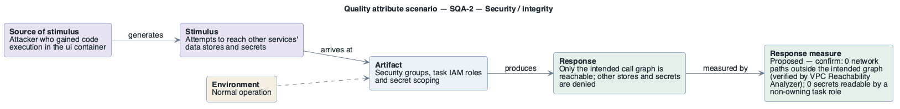

# SQA-2: Containment of a compromised service

- **Status**: at risk
- **Source**: authored here by `/drivers` (register mode) during the brownfield reconstruction

> **Derived — confirm.** Reconstructed from the deployed AWS environment (read-only evidence), not from a stakeholder. Treat as a hypothesis until confirmed. The response measure is a **proposed straw-man target** to bracket the discussion with the stakeholders — no SLO, alarm threshold or contract exists in the deployment to harvest one from.

| Part | Value |
|------|-------|
| **ID** | SQA-2 |
| **ISO/IEC 25010 characteristic** | Security |
| **Sub-characteristic** | integrity |
| **Source of stimulus** | Attacker who gained code execution in the `ui` container |
| **Stimulus** | Attempts to reach other services' data stores and secrets |
| **Artifact** | Security groups, task IAM roles and secret scoping |
| **Environment** | Normal operation |
| **Response** | Only the intended call graph is reachable; other stores and secrets are denied |
| **Response measure** | Proposed — confirm: 0 network paths outside the intended graph (verified by VPC Reachability Analyzer); 0 secrets readable by a non-owning task role |
| **Business goals supported** | BG-4 |
| **Priority** | Importance = H · Difficulty = M |
| **Candidate tactics** | *Security — resist attacks*: limit access, limit exposure, separate entities (per-service security groups and roles); *detect attacks*: detect intrusion. |
| **Type** | concrete |

## As-built evidence

Good: every data store's security group admits only its one client (3306 ← catalog, 5432 ← orders, 5671 ← orders, 6379 ← checkout, 443 ← catalog); secrets are scoped per execution role; separate task roles. Weak: all five task security groups allow TCP 8080 from `0.0.0.0/0` (in practice the whole VPC); `checkout-task` holds `dynamodb:*` on the carts table it does not use; ECS Exec is enabled on all services; Redis has no AUTH.

Evidence: [`aws/scoped/retail-store-ecs-evidence.json`](../../../aws/scoped/retail-store-ecs-evidence.json), [`aws/well-architected/well-architected-findings.md`](../../../aws/well-architected/well-architected-findings.md).

## Six-part scenario diagram

SEI six-part quality attribute scenario notation (no UML diagram type exists for it), drawn with PlantUML in the package's UML palette.

Source: [`diagrams/scenario-SQA-2.puml`](diagrams/scenario-SQA-2.puml) · rendered with PlantUML · visually verified: yes
