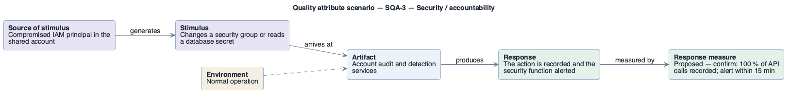

# SQA-3: Detection of suspicious control-plane activity

- **Status**: at risk
- **Source**: authored here by `/drivers` (register mode) during the brownfield reconstruction

> **Derived — confirm.** Reconstructed from the deployed AWS environment (read-only evidence), not from a stakeholder. Treat as a hypothesis until confirmed. The response measure is a **proposed straw-man target** to bracket the discussion with the stakeholders — no SLO, alarm threshold or contract exists in the deployment to harvest one from.

| Part | Value |
|------|-------|
| **ID** | SQA-3 |
| **ISO/IEC 25010 characteristic** | Security |
| **Sub-characteristic** | accountability |
| **Source of stimulus** | Compromised IAM principal in the shared account |
| **Stimulus** | Changes a security group or reads a database secret |
| **Artifact** | Account audit and detection services |
| **Environment** | Normal operation |
| **Response** | The action is recorded and the security function alerted |
| **Response measure** | Proposed — confirm: 100 % of API calls recorded; alert within 15 min |
| **Business goals supported** | BG-4 |
| **Priority** | Importance = H · Difficulty = L |
| **Candidate tactics** | *Security — detect attacks*: detect intrusion, maintain audit trail (CloudTrail), verify message integrity; *react*: alert actors. |
| **Type** | concrete |

## As-built evidence

No CloudTrail trail; GuardDuty, Security Hub and AWS Config are disabled in eu-central-1; no VPC Flow Logs; Application Load Balancer access logs off.

Evidence: [`aws/scoped/retail-store-ecs-evidence.json`](../../../aws/scoped/retail-store-ecs-evidence.json), [`aws/well-architected/well-architected-findings.md`](../../../aws/well-architected/well-architected-findings.md).

## Six-part scenario diagram

SEI six-part quality attribute scenario notation (no UML diagram type exists for it), drawn with PlantUML in the package's UML palette.

Source: [`diagrams/scenario-SQA-3.puml`](diagrams/scenario-SQA-3.puml) · rendered with PlantUML · visually verified: yes
