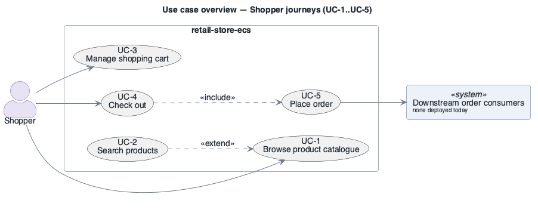
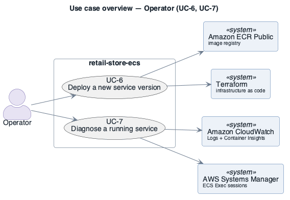

# Use cases

Index for `architecture/drivers/use-cases/`. One linked row per file. The authoritative traceability matrix is in the [drivers README](../README.md). All use cases are **derived — confirm** (reconstructed from the deployed services and their configuration).

| ID | Use case | Primary actor | Priority | Diagram | Status |
|----|----------|---------------|:--------:|---------|:------:|
| [UC-1](UC-1.md) | Browse product catalogue | Shopper | high | [UC-1](diagrams/UC-1.png) | open |
| [UC-2](UC-2.md) | Search products | Shopper | medium | [UC-2](diagrams/UC-2.png) | open |
| [UC-3](UC-3.md) | Manage shopping cart | Shopper | high | [UC-3](diagrams/UC-3.png) | open |
| [UC-4](UC-4.md) | Check out | Shopper | high | [UC-4](diagrams/UC-4.png) | open |
| [UC-5](UC-5.md) | Place order | Shopper | high | [UC-5](diagrams/UC-5.png) | open |
| [UC-6](UC-6.md) | Deploy a new service version | Operator | medium | [UC-6](diagrams/UC-6.png) | open |
| [UC-7](UC-7.md) | Diagnose a running service | Operator | medium | [UC-7](diagrams/UC-7.png) | open |

Overview diagrams:

Source: [`diagrams/overview-shopper.puml`](diagrams/overview-shopper.puml)

Source: [`diagrams/overview-operator.puml`](diagrams/overview-operator.puml)

---

**Navigation**: [drivers README](../README.md) · [architecture package](../../README.md)
