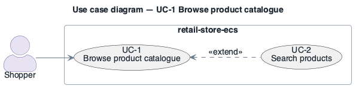

# UC-1: Browse product catalogue

> **Derived — confirm.** Reconstructed from the deployed AWS environment (read-only evidence), not from a stakeholder. Treat as a hypothesis until confirmed.

- **Scope**: retail-store-ecs (as deployed)
- **Level**: user goal
- **Primary actor**: Shopper
- **Supporting actors**: none outside the system (all collaborators are internal services)
- **Stakeholders and interests**:
  - ST-5 Shopper — the step works and personal data is protected
  - ST-3 Operator — failures are visible and recoverable
- **Trigger**: Shopper opens the storefront URL (`http://retail-store-ecs-ui-0000000000.eu-central-1.elb.amazonaws.com/`).
- **Preconditions**: ui and catalog services RUNNING; Aurora MySQL `retail-store-ecs-catalog` available.
- **Postconditions (success guarantee)**: Product list / detail page rendered; no state changed.
- **Priority**: high
- **Status**: open

## Main success scenario

1. Shopper requests a catalogue page over HTTP port 80 at the internet-facing Application Load Balancer.
2. The load balancer forwards to the `ui` task on HTTP 8080 (target group `ui-application`).
3. `ui` calls `http://catalog` (Service Connect alias, port 80) for products and tags.
4. `catalog` reads products from Aurora MySQL (`RETAIL_CATALOG_PERSISTENCE_PROVIDER=mysql`, TCP 3306).
5. `ui` also fetches the cart badge from `http://carts` and renders the page.

## Extensions / alternate flows

- **3a.** `catalog` unavailable (single task restarting): `ui` cannot render products; shopper sees an error page.
- **4a.** Aurora writer unavailable (single instance, no reader): catalogue requests fail until the instance recovers.

## Architectural significance

- **Drivers exercised**: [PQA-1](../quality-attributes/PQA-1.md), [AQA-1](../quality-attributes/AQA-1.md), [CON-2](../constraints/CON-2.md)
- **Notes**: Dominant read load; crosses the internet trust boundary; exercises Service Connect and the catalogue database.

## Related drivers

[BG-1](../business-goals/BG-1.md), [BG-2](../business-goals/BG-2.md), [PQA-1](../quality-attributes/PQA-1.md), [AQA-1](../quality-attributes/AQA-1.md), [CON-2](../constraints/CON-2.md)

## Use case diagram

Source: [`diagrams/UC-1.puml`](diagrams/UC-1.puml) · rendered with PlantUML · visually verified.
