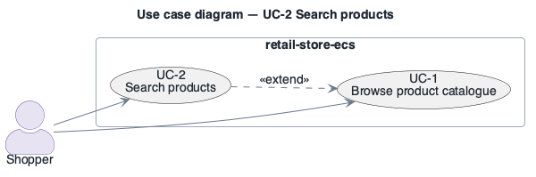

# UC-2: Search products

> **Derived — confirm.** Reconstructed from the deployed AWS environment (read-only evidence), not from a stakeholder. Treat as a hypothesis until confirmed.

- **Scope**: retail-store-ecs (as deployed)
- **Level**: user goal
- **Primary actor**: Shopper
- **Supporting actors**: none outside the system (all collaborators are internal services)
- **Stakeholders and interests**:
  - ST-5 Shopper — the step works and personal data is protected
  - ST-3 Operator — failures are visible and recoverable
- **Trigger**: Shopper submits a search term in the storefront (`RETAIL_UI_SEARCH_ENABLED=true`).
- **Preconditions**: UC-1 preconditions; OpenSearch domain `retail-store-ecs-catalog` reachable; index `products` populated.
- **Postconditions (success guarantee)**: Matching products listed.
- **Priority**: medium
- **Status**: open

## Main success scenario

1. Shopper enters a search term on a catalogue page.
2. `ui` forwards the query to `http://catalog`.
3. `catalog` queries OpenSearch 3.3 over HTTPS 443 (fine-grained access control, credentials from Secrets Manager), index `products`.
4. `ui` renders the result list.

## Extensions / alternate flows

- **3a.** OpenSearch single node unavailable: search fails; browsing (UC-1) still works from Aurora MySQL.

## Architectural significance

- **Drivers exercised**: [PQA-1](../quality-attributes/PQA-1.md), [AQA-2](../quality-attributes/AQA-2.md), [MQA-1](../quality-attributes/MQA-1.md)
- **Notes**: Extends UC-1 conditionally (feature flag); adds a second data store to the catalogue service — a consistency and availability concern.

## Related drivers

[BG-2](../business-goals/BG-2.md), [PQA-1](../quality-attributes/PQA-1.md), [AQA-2](../quality-attributes/AQA-2.md), [MQA-1](../quality-attributes/MQA-1.md)

## Use case diagram

Source: [`diagrams/UC-2.puml`](diagrams/UC-2.puml) · rendered with PlantUML · visually verified.
