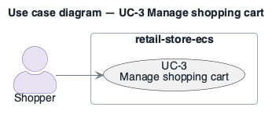

# UC-3: Manage shopping cart

> **Derived — confirm.** Reconstructed from the deployed AWS environment (read-only evidence), not from a stakeholder. Treat as a hypothesis until confirmed.

- **Scope**: retail-store-ecs (as deployed)
- **Level**: user goal
- **Primary actor**: Shopper
- **Supporting actors**: none outside the system (all collaborators are internal services)
- **Stakeholders and interests**:
  - ST-5 Shopper — the step works and personal data is protected
  - ST-3 Operator — failures are visible and recoverable
- **Trigger**: Shopper adds, updates or removes an item.
- **Preconditions**: ui and carts RUNNING; DynamoDB table `retail-store-ecs-carts` available.
- **Postconditions (success guarantee)**: Cart persisted in DynamoDB keyed by customer.
- **Priority**: high
- **Status**: open

## Main success scenario

1. Shopper adds an item from a product page.
2. `ui` calls `http://carts` via Service Connect.
3. `carts` writes the cart item to DynamoDB `retail-store-ecs-carts` (on-demand; GSI `idx_global_customerId`) over HTTPS 443 through the NAT Gateway.
4. `ui` shows the updated cart.

## Extensions / alternate flows

- **3a.** NAT Gateway (single, eu-central-1a) unavailable: DynamoDB is unreachable (no gateway endpoint) and cart writes fail in every Availability Zone.

## Architectural significance

- **Drivers exercised**: [AQA-2](../quality-attributes/AQA-2.md), [SCQA-1](../quality-attributes/SCQA-1.md)
- **Notes**: State-changing; the only data path that leaves the VPC (to a regional AWS endpoint), making it depend on the NAT Gateway.

## Related drivers

[BG-2](../business-goals/BG-2.md), [AQA-2](../quality-attributes/AQA-2.md), [SCQA-1](../quality-attributes/SCQA-1.md)

## Use case diagram

Source: [`diagrams/UC-3.puml`](diagrams/UC-3.puml) · rendered with PlantUML · visually verified.
