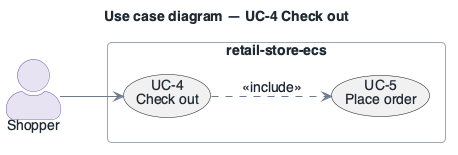

# UC-4: Check out

> **Derived — confirm.** Reconstructed from the deployed AWS environment (read-only evidence), not from a stakeholder. Treat as a hypothesis until confirmed.

- **Scope**: retail-store-ecs (as deployed)
- **Level**: user goal
- **Primary actor**: Shopper
- **Supporting actors**: none outside the system (all collaborators are internal services)
- **Stakeholders and interests**:
  - ST-5 Shopper — the step works and personal data is protected
  - ST-3 Operator — failures are visible and recoverable
- **Trigger**: Shopper starts checkout from a non-empty cart.
- **Preconditions**: ui, checkout, orders RUNNING; ElastiCache Redis `retail-store-ecs-checkout` available.
- **Postconditions (success guarantee)**: Order submitted (UC-5) and checkout session cleared.
- **Priority**: high
- **Status**: open

## Main success scenario

1. Shopper enters shipping details and selects delivery.
2. `ui` calls `http://checkout`; `checkout` stores the in-progress checkout in Redis (`redis://…:6379`, no TLS, no AUTH).
3. Shopper confirms; `checkout` submits the order to `http://orders` (UC-5).
4. `ui` shows the order confirmation.

## Extensions / alternate flows

- **2a.** Redis node (single, no replica) lost: in-progress checkouts are lost; shopper must restart checkout.
- **3a.** `orders` unavailable: checkout cannot complete; no retry or outbox exists at the infrastructure level.

## Architectural significance

- **Drivers exercised**: [AQA-1](../quality-attributes/AQA-1.md), [SQA-1](../quality-attributes/SQA-1.md), [SQA-2](../quality-attributes/SQA-2.md)
- **Notes**: Carries PII across three services; the synchronous chain ui → checkout → orders → databases is the longest call path.

## Related drivers

[BG-2](../business-goals/BG-2.md), [BG-4](../business-goals/BG-4.md), [AQA-1](../quality-attributes/AQA-1.md), [SQA-1](../quality-attributes/SQA-1.md), [SQA-2](../quality-attributes/SQA-2.md)

## Use case diagram

Source: [`diagrams/UC-4.puml`](diagrams/UC-4.puml) · rendered with PlantUML · visually verified.
