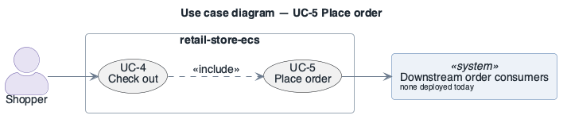

# UC-5: Place order

> **Derived — confirm.** Reconstructed from the deployed AWS environment (read-only evidence), not from a stakeholder. Treat as a hypothesis until confirmed.

- **Scope**: retail-store-ecs (as deployed)
- **Level**: subfunction
- **Primary actor**: Shopper
- **Supporting actors**: Downstream order consumers (none deployed today)
- **Stakeholders and interests**:
  - ST-5 Shopper — the step works and personal data is protected
  - ST-3 Operator — failures are visible and recoverable
- **Trigger**: `checkout` submits a confirmed checkout to `orders` (included by UC-4).
- **Preconditions**: Aurora PostgreSQL `retail-store-ecs-orders` and Amazon MQ broker `retail-store-ecs-orders-broker` available.
- **Postconditions (success guarantee)**: Order row stored; order-created event published to RabbitMQ.
- **Priority**: high
- **Status**: open

## Main success scenario

1. `orders` receives the order over HTTP via Service Connect.
2. `orders` writes the order to Aurora PostgreSQL 15.10 (TCP 5432; `rds.force_ssl=0`).
3. `orders` publishes an order event to RabbitMQ 3.13 on Amazon MQ over AMQPS 5671 (`RETAIL_ORDERS_MESSAGING_PROVIDER=rabbitmq`).
4. Any subscribed downstream consumer receives the event asynchronously.

## Extensions / alternate flows

- **3a.** Broker (single instance) unavailable: publish fails; behaviour of the application on publish failure is not visible from infrastructure — ask ST-6.

## Architectural significance

- **Drivers exercised**: [INQA-1](../quality-attributes/INQA-1.md), [RQA-1](../quality-attributes/RQA-1.md), [AQA-2](../quality-attributes/AQA-2.md)
- **Notes**: The integration point of the system (asynchronous event); the only use case that writes PII to a database; included by UC-4.

## Related drivers

[BG-1](../business-goals/BG-1.md), [BG-2](../business-goals/BG-2.md), [BG-4](../business-goals/BG-4.md), [INQA-1](../quality-attributes/INQA-1.md), [RQA-1](../quality-attributes/RQA-1.md), [AQA-2](../quality-attributes/AQA-2.md)

## Use case diagram

Source: [`diagrams/UC-5.puml`](diagrams/UC-5.puml) · rendered with PlantUML · visually verified.
