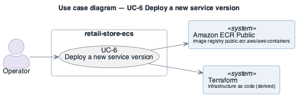

# UC-6: Deploy a new service version

> **Derived — confirm.** Reconstructed from the deployed AWS environment (read-only evidence), not from a stakeholder. Treat as a hypothesis until confirmed.

- **Scope**: retail-store-ecs (as deployed)
- **Level**: user goal
- **Primary actor**: Operator
- **Supporting actors**: Amazon ECR Public (image registry public.ecr.aws/aws-containers), Terraform (infrastructure as code (derived))
- **Stakeholders and interests**:
  - ST-5 Shopper — the step works and personal data is protected
  - ST-3 Operator — failures are visible and recoverable
- **Trigger**: A new image tag (e.g. beyond 1.6.3) or a configuration change is to be released.
- **Preconditions**: New task-definition revision prepared (Terraform).
- **Postconditions (success guarantee)**: Service runs the new revision; old tasks drained.
- **Priority**: medium
- **Status**: open

## Main success scenario

1. Operator applies the Terraform change, registering a new task-definition revision.
2. ECS starts new tasks (rolling: minimum healthy 100 %, maximum 200 %), pulling the image from ECR Public through the NAT Gateway.
3. New tasks pass the container health check (`curl /health` or `/actuator/health`) and, for `ui`, the target-group health check.
4. ECS stops the old tasks.

## Extensions / alternate flows

- **3a.** New version never becomes healthy: deployment circuit breaker is disabled, so ECS keeps retrying; no automatic rollback.
- **2a.** ECR Public unreachable or rate-limited: tasks cannot start (no private mirror).

## Architectural significance

- **Drivers exercised**: [DQA-1](../quality-attributes/DQA-1.md), [CON-3](../constraints/CON-3.md), [CON-6](../constraints/CON-6.md)
- **Notes**: Deployability and change risk; depends on an external registry and the NAT Gateway.

## Related drivers

[BG-1](../business-goals/BG-1.md), [BG-3](../business-goals/BG-3.md), [BG-4](../business-goals/BG-4.md), [DQA-1](../quality-attributes/DQA-1.md), [CON-3](../constraints/CON-3.md), [CON-6](../constraints/CON-6.md)

## Use case diagram

Source: [`diagrams/UC-6.puml`](diagrams/UC-6.puml) · rendered with PlantUML · visually verified.
