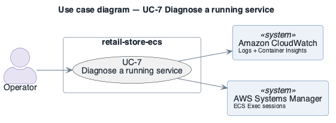

# UC-7: Diagnose a running service

> **Derived — confirm.** Reconstructed from the deployed AWS environment (read-only evidence), not from a stakeholder. Treat as a hypothesis until confirmed.

- **Scope**: retail-store-ecs (as deployed)
- **Level**: user goal
- **Primary actor**: Operator
- **Supporting actors**: Amazon CloudWatch (Logs + Container Insights), AWS Systems Manager (ECS Exec sessions)
- **Stakeholders and interests**:
  - ST-5 Shopper — the step works and personal data is protected
  - ST-3 Operator — failures are visible and recoverable
- **Trigger**: A shopper-visible fault is reported (there are no alarms to raise one automatically).
- **Preconditions**: Operator holds IAM permissions for logs and ECS Exec.
- **Postconditions (success guarantee)**: Fault located.
- **Priority**: medium
- **Status**: open

## Main success scenario

1. Operator inspects Container Insights (enhanced) metrics for the cluster `retail-store-ecs-cluster`.
2. Operator reads the service's stream in log group `retail-store-ecs-tasks` (prefix `<service>-service`).
3. If needed, operator opens a shell in the task with ECS Exec (enabled on all services).
4. Operator identifies the failing component.

## Extensions / alternate flows

- **1a.** Fault older than 1 day: Container Insights performance logs are already expired (retention 1 day).

## Architectural significance

- **Drivers exercised**: [OQA-1](../quality-attributes/OQA-1.md), [SQA-3](../quality-attributes/SQA-3.md)
- **Notes**: Observability is entirely manual: no alarms, no dashboards, no tracing; ECS Exec is a privileged path into every container.

## Related drivers

[BG-4](../business-goals/BG-4.md), [OQA-1](../quality-attributes/OQA-1.md), [SQA-3](../quality-attributes/SQA-3.md)

## Use case diagram

Source: [`diagrams/UC-7.puml`](diagrams/UC-7.puml) · rendered with PlantUML · visually verified.
